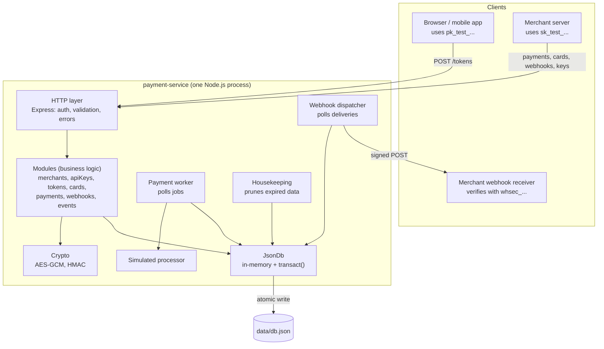
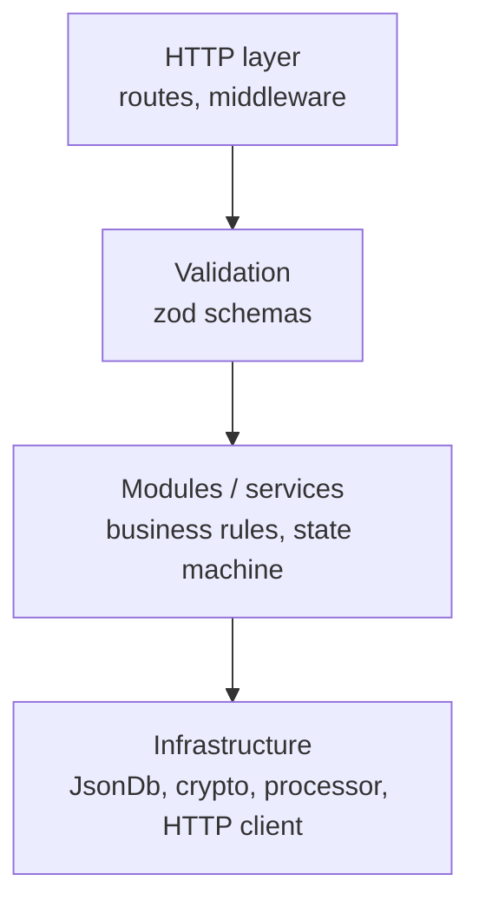
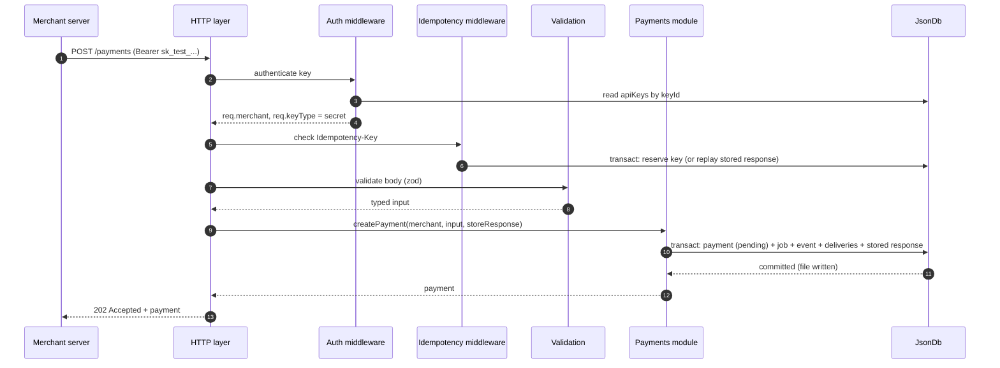

# 1. Architecture

## 1.1 Overview

The service is a **single Node.js process** that contains three things:

1. An **HTTP API** that merchants and their clients call.
2. A **payment worker** that processes queued payment jobs in the background.
3. A **webhook dispatcher** that delivers events to merchants' callback URLs.

All three share **one in-memory database instance**, which is mirrored to a JSON file.



## 1.2 Layers

Each layer only calls the layer directly beneath it. Dependencies are passed in as arguments (dependency injection) instead of being imported as global singletons.



| Layer | Responsibility | Knows nothing about |
|---|---|---|
| **HTTP** | Parse requests, authenticate the API key, map errors to status codes | Business rules, storage |
| **Validation** | Reject malformed input with field-level error messages | Storage, HTTP status codes |
| **Modules** | Business rules: state transitions, amount checks, encryption decisions, event emission | HTTP, file formats |
| **Infrastructure** | Storage, cryptography, the fake processor, outbound HTTP | Business rules |

**Why layered:**

- **Testability.** Modules can be tested with a temp database and a fake processor, without starting an HTTP server.
- **Replaceability.** If the JSON file is swapped for Postgres later, only the infrastructure layer changes.
- **Clarity.** When something breaks, its layer tells you where to look. A 400 error comes from validation; a 409 comes from a business rule.

**Why dependency injection rather than global imports:** tests need to substitute a temp DB file, a zero-latency processor or a fake clock. Passing dependencies in makes that trivial, with no mocking libraries.

## 1.3 Modules

| Module | Owns | Main operations |
|---|---|---|
| `merchants` | Merchant accounts | Sign up (creates the first key pair), get the current merchant |
| `apiKeys` | Publishable and secret keys | Authenticate a request, rotate a key, list keys |
| `tokens` | Single-use card tokens | Create a token from raw card details |
| `cards` | Encrypted card vault | Save, list, get, delete a card; decrypt for the worker only |
| `payments` | Payments and their jobs | Create, get, list, update, request capture/refund/cancel |
| `webhooks` | Endpoints and deliveries | Register, update, delete, rotate secret, list deliveries |
| `events` | The event log / outbox | Record an event and fan it out to endpoints; list events |

**Why a separate `events` module:** every module that changes a payment must emit an event *in the same transaction* (see [Webhooks](06-webhooks.md#63-the-outbox-how-events-are-never-lost)). Putting that in one place guarantees every event has the same shape, and that no module forgets to create the deliveries.

## 1.4 Background processes

Three loops run inside the same process as the HTTP server:

| Loop | Default interval | What it does |
|---|---|---|
| **Payment worker** | every 500 ms | Claims due jobs, calls the simulated processor, applies the result |
| **Webhook dispatcher** | every 1 s | Claims due deliveries, sends signed HTTP POSTs, schedules retries |
| **Housekeeping** | every 10 min | Deletes expired tokens, expired idempotency records, and old completed jobs, events and deliveries |

**Why in-process instead of separate worker processes:** the JSON file database can only be safely owned by **one process** (see [Persistence](07-persistence.md#710-limitations)). A separate worker process would need a second writer on the same file, which would lose updates. Running the loops in-process keeps a single owner of the data.

**Why polling instead of an in-memory event emitter:** jobs and deliveries are stored in the database, so they **survive a crash or restart**. An in-memory queue would lose pending work if the process died. Polling an in-memory index of due jobs is cheap, so it costs almost nothing.

## 1.5 Request lifecycle

A typical authenticated request, creating a payment:



**Why 202 Accepted rather than 201 Created:** the payment record exists, but its outcome (approved or declined) **isn't known yet**. 202 tells the client the request was accepted for processing and the final result will arrive later, by webhook or by polling `GET /payments/:id`.

## 1.6 Configuration

All configuration comes from environment variables. The service **refuses to start** if a required variable is missing or invalid.

| Variable | Required | Default | Purpose |
|---|---|---|---|
| `PORT` | no | `3000` | HTTP port |
| `DB_FILE` | no | `data/db.json` | Path to the database file |
| `ENCRYPTION_KEYS` | **yes** | – | Versioned AES-256 keys, e.g. `v1:<base64>,v2:<base64>` |
| `ENCRYPTION_ACTIVE_KEY_ID` | **yes** | – | Which key encrypts new data, e.g. `v2` |
| `HASHING_SECRET` | **yes** | – | Secret for API key hashes and card fingerprints (≥ 32 bytes, base64) |
| `PROCESSOR_LATENCY_MS` | no | `300` | Simulated processor delay |
| `PROCESSOR_FAILURE_RATE` | no | `0` | Probability (0–1) of a simulated transient processor error, for exercising retries |
| `PROCESSOR_TIMEOUT_MS` | no | `10000` | Time limit for each processor call (100–25000, kept below the 30 s job lease). A call that hasn't answered is abandoned and retried (see [Lifecycle §3.4](03-payment-lifecycle.md#34-the-payment-worker)) |
| `WORKER_CONCURRENCY` | no | `5` | Maximum jobs processed at the same time |
| `WEBHOOK_ALLOW_INSECURE_URLS` | no | `false` | Allow `http://` and private/loopback webhook URLs (local development only) |
| `RETENTION_DAYS` | no | `7` | How long completed jobs, events and deliveries are kept |
| `DB_WARN_SIZE_MB` | no | `10` | Log a warning when the database file outgrows the design capacity (see [Persistence §7.9](07-persistence.md#79-performance-and-capacity)) |
| `LOG_LEVEL` | no | `info` | Minimum log level: `debug`, `info`, `warn`, `error`, `fatal` (see [Error handling §8.6](08-error-handling.md#86-server-logging)) |
| `RATE_LIMIT_SIGNUP_PER_HOUR` | no | `5` | Sign-ups per IP per hour (see [Security §4.9](04-security.md#49-rate-limiting)) |
| `RATE_LIMIT_TOKENS_PER_MINUTE` | no | `60` | `POST /tokens` calls per API key per minute |
| `RATE_LIMIT_GENERAL_PER_MINUTE` | no | `300` | All other authenticated calls per API key per minute |

**Why fail fast on startup:** a payment service running with a missing encryption key would either crash on the first card, or worse, store data it can never decrypt. Failing at boot makes a misconfiguration obvious right away.

**Why environment variables:** this is the standard way to pass secrets to a process without committing them to the repository (the [twelve-factor](https://12factor.net/config) approach). `yarn gen:secrets` creates `.env` (from `.env.example`) with randomly generated **placeholder** secrets and a comment explaining they should be replaced with your own random values. It never overwrites existing keys unless run with `--force`, because changing keys on an existing database makes stored card numbers and webhook secrets unreadable and invalidates every issued secret API key.

## 1.7 Project layout

```
payment-service/
├── docs/                       ← you are here
├── src/
│   ├── server.ts               entry point: load config, open DB, start HTTP + loops
│   ├── app.ts                  builds the Express app (no listen, so tests can use it)
│   ├── config.ts               reads and validates environment variables
│   ├── errors.ts               AppError hierarchy → HTTP status codes
│   ├── logging/
│   │   ├── logger.ts           the only code that writes to the console
│   │   └── redact.ts           key- and pattern-based redaction
│   ├── crypto/
│   │   ├── encryption.ts       AES-256-GCM with key versions + AAD
│   │   └── hashing.ts          HMAC helpers, constant-time compare, key generation
│   ├── db/
│   │   ├── jsonDb.ts           transactional file-backed store
│   │   └── schema.ts           TypeScript types for every collection
│   ├── http/
│   │   ├── middleware/         auth, idempotency, rate limit, error handler
│   │   └── routes/             one router per module
│   ├── modules/
│   │   ├── merchants/  apiKeys/  tokens/  cards/
│   │   ├── payments/  webhooks/  events/
│   │   └── (each: service.ts + schemas.ts)
│   ├── processor/
│   │   └── simulatedProcessor.ts
│   └── workers/
│       ├── paymentWorker.ts
│       ├── webhookDispatcher.ts
│       └── housekeeping.ts
├── scripts/
│   ├── generate-secrets.ts
│   └── bench-db.ts             measures commit time at 1k / 10k / 50k payments
└── test/
```

**Why `app.ts` is separate from `server.ts`:** tests build the app on a random port with a temp database, without starting background loops or binding port 3000.

**Why each module folder has its own `schemas.ts`:** validation rules live next to the logic they protect, so changing a field means editing one folder.

## 1.8 Error model

Every error response has the same shape:

```json
{
  "error": {
    "code": "validation_error",
    "message": "Invalid request",
    "details": [{ "field": "amountMinor", "message": "must be a positive integer" }],
    "requestId": "req_1b7f0c9e2d4a4f3b8c6d5e7f9a0b1c2d"
  }
}
```

How errors are classified, logged and kept free of sensitive data is covered in [Error handling](08-error-handling.md).

| Status | `code` | When |
|---|---|---|
| 400 | `validation_error`, `invalid_json` | Malformed or invalid input |
| 401 | `unauthorized` | Missing, malformed, unknown or revoked API key |
| 403 | `forbidden` | Valid key, wrong type (e.g. a publishable key calling `/payments`) |
| 404 | `not_found` | The resource doesn't exist **or belongs to another merchant** |
| 409 | `invalid_state`, `idempotency_in_progress`, `conflict` | Not allowed in the current state |
| 413 | `payload_too_large` | Request body over 100 kb |
| 422 | `idempotency_key_reused` | Same `Idempotency-Key` sent with a different request body |
| 429 | `rate_limited` | Too many requests. Includes `Retry-After` |
| 500 | `internal_error` | Unexpected failure: a bug or a security event. Details are logged, never returned |
| 503 | `service_unavailable` | Temporary storage failure, nothing was changed. Includes `Retry-After` |

**Why every error includes `requestId`:** a client can quote it, and one search of the server logs finds the full story of that request (see [Error handling §8.5](08-error-handling.md#85-request-ids)).

**Why 404 (not 403) for another merchant's resource:** a 403 would confirm that the ID exists. Returning 404 means one merchant can't discover anything about another merchant's data.

**Why a stable `code` field in addition to `message`:** client code should branch on `code`, which never changes. `message` is for humans and may be reworded.

## 1.9 Tests

How these tests are run, and the fakes they use, is described in [Testing strategy](09-testing.md).

### Configuration

| Test | Checks | Edge case guarded |
|---|---|---|
| Each required variable missing in turn → exit 1, `fatal` log names the variable | Fail fast (§1.6) | A service running without an encryption key and failing on the first card |
| `ENCRYPTION_KEYS` with a key that isn't 32 bytes, bad base64, or a duplicate version → exit 1 | Key format validation | A short key silently weakening AES-256, or two keys claiming to be `v1` |
| `ENCRYPTION_ACTIVE_KEY_ID` not in `ENCRYPTION_KEYS` → exit 1 | Cross-variable consistency | Encrypting with a key that doesn't exist |
| `HASHING_SECRET` under 32 bytes → exit 1 | Minimum secret strength | A weak secret behind every API key hash |
| Out-of-range values (`PORT=abc`, `WORKER_CONCURRENCY=0`, `PROCESSOR_FAILURE_RATE=1.5`, `RETENTION_DAYS=-1`) → exit 1 | Numeric validation | Nonsense values producing confusing behaviour later instead of a clear error now |
| Config error output never contains the invalid **value** | Secrets stay out of logs | A malformed master key printed in a startup error |
| Optional variables unset → documented defaults apply | Defaults table (§1.6) | Defaults drifting away from the docs |

### App wiring

| Test | Checks | Edge case guarded |
|---|---|---|
| `GET /health` → `200 {"status":"ok"}` | Liveness endpoint | – |
| Unknown route → `404` JSON error body with `requestId` | Error model applies everywhere | Express's default HTML 404 page revealing the framework |
| Every response (success or error) has an `X-Request-Id` header | Request ID middleware runs first | Errors thrown before routing (e.g. invalid JSON) having no ID |
| Building the app (`createApp`) starts no timers and opens no port | `app.ts` / `server.ts` split (§1.7) | Tests accidentally starting background loops or binding port 3000 |
| Port already in use → `fatal` log + exit 1 | Startup failure handling | A process that stays alive without listening |

### Background loops

| Test | Checks | Edge case guarded |
|---|---|---|
| After `close()`, no further tick runs | Loops stop cleanly | A tick firing during shutdown and writing after the lock is released |
| `SIGTERM` to a running server (process test) → stops accepting, finishes queued transactions, removes the lock, exits 0 | Graceful shutdown | Losing an in-flight commit on every deploy or restart |
| Process killed with `SIGKILL` mid-job, then restarted → job reclaimed after its lease and completed | Durable jobs (§1.4) | Work lost when the process dies without warning |
