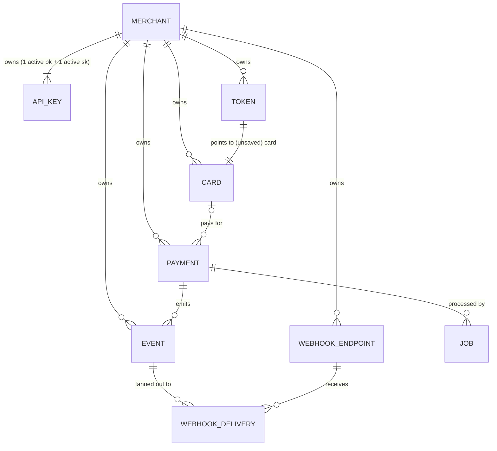
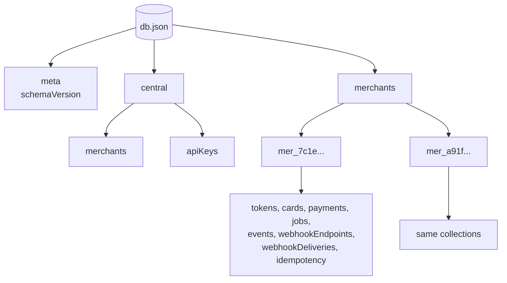

# 2. Data Model

## 2.1 Conventions

These rules apply to every record.

| Convention | Rule | Why |
|---|---|---|
| **IDs** | `<prefix>_<32 hex chars>`, from `crypto.randomUUID()` with the dashes removed, e.g. `pay_3f9c…` | The prefix shows what an ID refers to in logs and support tickets, and stops a card ID being passed where a payment ID is expected. Random UUIDs can't be guessed or enumerated, unlike sequential numbers |
| **Amounts** | Integers in the currency's **minor (smallest) unit**, in fields whose names end in `Minor` (`amountMinor`, `amountCapturedMinor`, `amountRefundedMinor`). `1050` USD = $10.50. **JPY has no minor unit**, so `2500` JPY = ¥2500 | Floating-point maths is inexact (`0.1 + 0.2 !== 0.3`), and integers make money arithmetic exact. The `Minor` suffix puts the unit in the name, so nobody can mistake `2500` for $2,500 |
| **Currency** | Uppercase ISO 4217 code (`USD`). Supported: USD, EUR, GBP, CAD, AUD, NGN, JPY | A standard, unambiguous code. A short list keeps validation simple |
| **Timestamps** | ISO 8601 strings in UTC (`2026-10-15T09:30:00.000Z`) | Human-readable in the JSON file, sort correctly as plain strings, and carry no time-zone ambiguity |
| **Nullable fields** | Use `null`, never omit the key | Every record of a type has the same keys, which makes the JSON file and API responses predictable |
| **Tenancy** | Merchant-owned records are stored **inside their merchant's subtree** (§2.3), and also carry a `merchantId` field | The subtree makes isolation structural: code for one merchant never sees another's data. The `merchantId` field keeps a record self-describing when it's copied out of its subtree (event snapshots, exports, a future per-merchant file or archive) |

**ID prefixes:** `mer_` merchant · `key_` API key · `tok_` token · `card_` card · `pay_` payment · `job_` job · `evt_` event · `we_` webhook endpoint · `whd_` webhook delivery.

## 2.2 Entity relationships



## 2.3 The database file

The whole database is **one JSON document**, split into two **scopes** (see [Persistence §7.2](07-persistence.md#72-interface-scoped-transactions)):

- **central**: data needed before we know which merchant is calling;
- **merchants**: one entry per merchant, holding everything that belongs to that merchant.

Each collection is an object keyed by record ID.

```ts
interface DatabaseSchema {
  meta: { schemaVersion: 2 };   // v2: money fields renamed to *Minor (migrated automatically from v1)
  central: {
    merchants: Record<string, Merchant>;
    apiKeys: Record<string, ApiKey>;
  };
  merchants: Record<string /* merchantId */, {
    tokens: Record<string, Token>;
    cards: Record<string, Card>;
    payments: Record<string, Payment>;
    jobs: Record<string, Job>;
    events: Record<string, Event>;
    webhookEndpoints: Record<string, WebhookEndpoint>;
    webhookDeliveries: Record<string, WebhookDelivery>;
    idempotency: Record<string, IdempotencyRecord>;
  }>;
}
```



**Why group data by merchant instead of one flat collection per type:**
- **Isolation by structure.** Code working on a merchant only gets that merchant's subtree, so it can't read another merchant's records, even by mistake.
- **Cheaper writes.** A transaction copies only the subtree it changes.
- **Ready for splitting.** Each subtree could become its own file later without changing business code (see [Persistence §7.11](07-persistence.md#711-scaling-options-considered)).

**Why `central` holds merchants and API keys:** authentication has to find a key *before* it knows the merchant, so keys can't live inside a merchant's subtree.

**Why objects keyed by ID instead of arrays:** looking up a record by ID is `O(1)` (`db.payments[id]`) instead of scanning an array. Every authenticated request and every job does at least one ID lookup.

**Why `meta.schemaVersion`:** if a field is renamed later, the service can tell which shape the file on disk has and migrate it at startup, instead of crashing on unexpected data.

## 2.4 Collections

### Merchant

```ts
interface Merchant {
  id: string;              // mer_…
  name: string;            // 1–100 chars
  email: string;           // unique across merchants
  createdAt: string;
  updatedAt: string;
}
```

**Why `email` is unique:** sign-up is open (see the [README](README.md#intentional-decision-open-merchant-sign-up)), and a unique email stops accidental duplicate accounts. Emails are compared **case-insensitively** (stored lowercased), because `Dev@Acme.test` and `dev@acme.test` reach the same inbox. It is **not** verified, because identity verification is out of scope.

### ApiKey

```ts
interface ApiKey {
  id: string;                      // key_<16 hex>, also embedded in the key string itself
  merchantId: string;
  type: 'publishable' | 'secret';
  status: 'active' | 'revoked';
  publishableKey: string | null;   // full pk_test_… value (publishable keys only)
  secretHash: string | null;       // HMAC-SHA256 of the secret part (secret keys only)
  last4: string;                   // last 4 chars, for display: "sk_test_…a1b2"
  createdAt: string;
  revokedAt: string | null;
}
```

A key string looks like `sk_test_<16-hex id>_<43-char random secret>`. The record's ID is embedded in the key, so authentication does a **direct lookup** (`apiKeys["key_" + id]`) and then compares hashes.

| Decision | Why |
|---|---|
| Secret keys stored only as a hash | If `db.json` leaks, the keys can't be used. The full secret key is shown **once**, at creation or rotation |
| Publishable keys stored in plain text | They're public by design (they ship in browser code), and the merchant needs to read them back from `GET /api-keys` |
| ID embedded in the key | Makes authentication `O(1)` without storing the plain key or scanning every hash |
| Exactly one active key of each type | Rotation is the only way to replace a key (see [Security](04-security.md#api-key-rotation)). One active key per type means "which key is current?" always has a single answer |
| `lastUsedAt` **not** tracked | It would turn every read request into a database write, and each write rewrites the whole file (see [Persistence](07-persistence.md#79-performance-and-capacity)) |

### Token

```ts
interface Token {
  id: string;              // tok_…
  merchantId: string;
  cardId: string;          // the unsaved Card record holding the encrypted number
  expiresAt: string;       // createdAt + 15 minutes
  usedAt: string | null;   // set when consumed by POST /payments or POST /cards
  createdAt: string;
}
```

| Decision | Why |
|---|---|
| Single use | A token that leaked from a browser can't be charged repeatedly |
| 15-minute expiry | Long enough to finish a checkout, short enough that abandoned tokens don't pile up |
| Points to a `Card` record instead of holding card data | There's one place (the vault) where encrypted card numbers live, and one code path to encrypt, decrypt and purge them |

### Card (the vault)

```ts
interface Card {
  id: string;                     // card_…
  merchantId: string;
  customerId: string | null;      // merchant-supplied plain string, not validated
  saved: boolean;                 // false = temporary (token or one-off payment)
  numberEncrypted: string | null; // "v1:<iv>:<tag>:<ciphertext>"; null once purged
  fingerprint: string;            // HMAC of the card number, for duplicate detection
  brand: 'visa' | 'mastercard' | 'amex' | 'discover' | 'unknown';
  last4: string;
  expMonth: number;               // 1–12
  expYear: number;                // 4 digits
  createdAt: string;
}
```

| Decision | Why |
|---|---|
| **Every** card goes through the vault, saved or not | The async worker needs the card number *after* the HTTP request has finished. Keeping it only in memory would lose it on a restart |
| Unsaved cards are deleted after authorization | Card data is kept no longer than it's needed |
| The CVC is **never** stored, not even encrypted | PCI DSS forbids keeping it after authorization. It's validated when the request arrives, then discarded. See [Security](04-security.md#45-cvc) |
| `brand`, `last4`, expiry kept in plain text | Safe to display, and needed to show "Visa •••• 4242" without decrypting anything |
| `fingerprint` | Lets the service detect "this customer already saved this card" by comparing HMACs, without decrypting every card |
| `customerId` is an unvalidated string | Merchants already have their own customer IDs. A full `/customers` resource is out of scope, and a plain string covers the "list this customer's cards" need |

### Payment

```ts
type PaymentStatus =
  | 'pending'            // created, waiting for authorization
  | 'authorized'         // funds reserved, not yet captured
  | 'capturing'          // capture job queued or running
  | 'captured'
  | 'refunding'          // refund job queued or running
  | 'partially_refunded'
  | 'refunded'
  | 'cancelling'         // cancel job queued or running
  | 'cancelled'
  | 'failed';            // authorization declined or permanently failed

interface Payment {
  id: string;                             // pay_…
  merchantId: string;
  status: PaymentStatus;
  amountMinor: number;                         // authorized/requested amount, minor units
  currency: string;
  captureMethod: 'automatic' | 'manual';  // automatic = capture right after authorizing
  amountCapturedMinor: number;
  amountRefundedMinor: number;
  customerId: string | null;
  description: string | null;             // ≤ 500 chars
  metadata: Record<string, string>;       // ≤ 20 keys; key ≤ 40 chars, value ≤ 500 chars
  paymentMethod: {
    type: 'card';
    cardId: string | null;                // set only if the card is saved
    brand: string;
    last4: string;
    expMonth: number;
    expYear: number;
  };
  sourceCardId: string;                   // INTERNAL: vault card used by the worker (never returned by the API)
  saveCardOnApproval: boolean;            // INTERNAL: saveCard was requested; the card is saved only if authorization is approved
  authorizationCode: string | null;
  failure: { code: string; message: string } | null;
  pendingAction: {
    type: 'authorize' | 'capture' | 'refund' | 'cancel';
    amountMinor: number | null;
    jobId: string;
    previousStatus: PaymentStatus | null; // where to return if the action fails
    requestedAt: string;
  } | null;
  history: Array<{
    type: string;                         // e.g. 'created', 'authorized', 'refunded'
    at: string;
    amountMinor?: number;
    code?: string;
  }>;
  createdAt: string;
  updatedAt: string;
}
```

| Decision | Why |
|---|---|
| Transitional statuses (`capturing`, `refunding`, `cancelling`) | Actions are async. The status has to show that work is in flight, so a client polling the payment never sees a misleading final state |
| `pendingAction` with `previousStatus` | If a capture or refund permanently fails, the payment can be put back exactly where it was |
| At most **one** pending action at a time | Two concurrent refunds could together exceed the captured amount. Allowing one at a time removes that race. A second request gets `409 invalid_state` |
| Card snapshot in `paymentMethod` | The payment still shows "Visa •••• 4242" after the card is deleted from the vault |
| `captureMethod` enum instead of a boolean | `'manual'` reads more clearly than `capture: false`, and the enum leaves room for other capture modes |
| `history` array | A built-in audit trail of every transition, readable without searching the event log |
| `metadata` limits | Without them, a merchant could store megabytes per payment, and since every write rewrites the whole file, that would slow down every write |

### Job

```ts
interface Job {
  id: string;                       // job_…
  merchantId: string;
  paymentId: string;
  type: 'authorize' | 'capture' | 'refund' | 'cancel';
  amountMinor: number | null;            // for capture/refund
  status: 'queued' | 'running' | 'succeeded' | 'failed';
  attempts: number;
  maxAttempts: number;              // default 5
  runAt: string;                    // don't run before this time (used for backoff)
  lockedUntil: string | null;       // claim lease; expired lease = job can be reclaimed
  lastError: string | null;
  createdAt: string;
  updatedAt: string;
  completedAt: string | null;
}
```

**Why a lease (`lockedUntil`) instead of a simple "running" flag:** if the process crashes while a job is running, a plain flag would leave the job stuck as "running" forever. With a lease, the lock expires after 30 seconds and the job is picked up again automatically.

### Event

```ts
type EventType =
  | 'payment.created' | 'payment.authorized' | 'payment.captured'
  | 'payment.partially_refunded' | 'payment.refunded' | 'payment.cancelled'
  | 'payment.failed' | 'payment.updated' | 'payment.action_failed';

interface Event {
  id: string;                     // evt_…
  merchantId: string;
  type: EventType;
  data: {
    object: PaymentView;          // snapshot of the payment at the moment of the event
    action?: { type: 'capture' | 'refund' | 'cancel'; code: string; message: string }; // only on payment.action_failed
  };
  createdAt: string;
}
```

**Why a snapshot instead of just the payment ID:** an event describes what happened *at that moment*. If the receiver re-fetched the payment, a later change might already have overwritten the state the event is about.

### WebhookEndpoint

```ts
interface WebhookEndpoint {
  id: string;                     // we_…
  merchantId: string;
  url: string;
  events: EventType[] | ['*'];    // '*' = all events
  enabled: boolean;
  description: string | null;
  secretEncrypted: string;        // whsec_… encrypted with AES-256-GCM
  createdAt: string;
  updatedAt: string;
}
```

**Why `url` is unique per merchant (stored normalized):** two endpoints with the same URL would receive every event twice. Storing the normalized form (lowercase scheme and host, no default port, no `#fragment`) makes the uniqueness check a plain string comparison. A merchant can have at most **5** endpoints (see [API §5.9](05-api.md#59-webhooks)).

**Why the signing secret is encrypted, not hashed:** unlike an API key, the service needs the **original** secret every time it signs a delivery. A hash can't be reversed, so encryption is the only option. See [Security](04-security.md#what-is-protected-and-how).

### WebhookDelivery

```ts
interface WebhookDelivery {
  id: string;                     // whd_…
  merchantId: string;
  endpointId: string;
  eventId: string;
  status: 'pending' | 'sending' | 'succeeded' | 'failed';
  attempts: number;               // max 8
  nextAttemptAt: string;
  lockedUntil: string | null;
  lastAttemptAt: string | null;
  lastResponseStatus: number | null;
  lastError: string | null;
  createdAt: string;
  completedAt: string | null;
}
```

**Why one delivery per (event × endpoint):** each endpoint succeeds or fails on its own. A broken endpoint shouldn't delay delivery to a healthy one.

### IdempotencyRecord

```ts
interface IdempotencyRecord {
  id: string;                     // `${merchantId}:${method}:${path}:${idempotencyKey}`
  merchantId: string;
  requestHash: string;            // HMAC-SHA256 of the request body as canonical JSON (keys sorted)
  status: 'in_progress' | 'completed';
  responseStatus: number | null;
  responseBody: unknown | null;
  createdAt: string;
  expiresAt: string;              // createdAt + 24 h
}
```

**Why store the full response:** a retried request gets *exactly* the original response, including the original error, so clients can retry safely after a network timeout.
**Why hash the body:** if the same key is reused with a *different* body, that's almost certainly a client bug. The service returns `422 idempotency_key_reused` instead of silently replaying a response for a different request.
**Why a keyed hash (HMAC):** the body can contain a card number and CVC. A plain SHA-256 of it could be brute-forced from a copy of the file. The key is the `idempotency-request` sub-key of `HASHING_SECRET` (see [Security §4.4](04-security.md#the-hashing-secret)).
**Why a successful response is stored in the action's transaction:** the record is completed in the same transaction that creates the payment, token or card, or queues the capture, refund or cancel. A crash or failed write can't leave the action committed with its record still `in_progress`, which a retry would treat as abandoned and run again (see [API §5.1](05-api.md#idempotency)).

## 2.5 What the API returns vs. what is stored

Internal fields are **never** returned. Each module has a `toView()` function that builds the public object.

| Collection | Never returned |
|---|---|
| ApiKey | `secretHash` |
| Card | `numberEncrypted`, `fingerprint` |
| Payment | `sourceCardId`, `saveCardOnApproval`, `merchantId`, and `pendingAction.jobId` / `pendingAction.previousStatus` (the public `pendingAction` is `{ type, amountMinor, requestedAt }`) |
| WebhookEndpoint | `secretEncrypted` (the plain secret is returned once, at creation or rotation) |

**Why an explicit `toView()` instead of deleting fields from the stored object:** with an allow-list, a field added later is hidden by default until someone deliberately exposes it. A block-list would leak new fields by default.

## 2.6 Data retention

The housekeeping loop (see [Architecture](01-architecture.md#14-background-processes)) deletes:

| Data | When |
|---|---|
| Tokens (used or not) | After `expiresAt` |
| Unsaved cards | When their token expires unused, or right after authorization. **Never** while a `pending` payment still needs them |
| Idempotency records | After `expiresAt` (24 h) |
| Succeeded or failed jobs | `RETENTION_DAYS` after completion (default 7) |
| Events, and deliveries that are finished | `RETENTION_DAYS` after creation |

Payments, saved cards, merchants, keys and endpoints are **never** deleted automatically.

**Why prune at all:** every write rewrites the whole JSON file, so write speed depends on file size. Without pruning, the operational records (jobs, events, deliveries) would grow forever and every write would get slower.

## 2.7 Tests

### Public views

| Test | Checks | Edge case guarded |
|---|---|---|
| For every resource (merchant, API key, token, card, payment, webhook endpoint, delivery, event), the keys of the API object **exactly equal** the documented list | `toView()` allow-lists (§2.5) | A new internal field (e.g. `sourceCardId`, `numberEncrypted`, `secretHash`) leaking into responses |
| Payment made with a card that's later deleted still shows `brand` and `last4` | Card snapshot on the payment | A payment losing its display details when the vault entry goes |

### IDs and value rules

| Test | Checks | Edge case guarded |
|---|---|---|
| Each ID type matches `<prefix>_<32 hex>`. 10,000 generated IDs are all unique | ID convention (§2.1) | Wrong prefixes, or a broken random source producing duplicates |
| Amounts: `1` and `99999999` accepted. `0`, `-1`, `10.5`, `"1000"`, `100000000`, `null` → 400 | Integers in minor units only | Floating-point money, or strings being quietly converted to numbers |
| Currency: `"usd"` → stored as `"USD"`. `"US"`, `"XYZ"`, `840` → 400 | Normalisation + allow-list | Case differences creating "different" currencies |
| Metadata: 20 keys accepted, 21 → 400. Key of 40 chars accepted, 41 → 400. Value of 500 chars accepted, 501 → 400. Number or object value → 400 | Size caps (§2.4 Payment) | Oversized records slowing every write for everyone |
| Metadata `null` value: deletes the key in `PATCH`, rejected in `POST /payments` | `null` means "delete", and only where deleting makes sense | Ambiguous `null`s being stored as values |
| `description` of 500 chars accepted, 501 → 400 | Size cap | Same as above |
| Sign-up with `Dev@Acme.test` after `dev@acme.test` → `409 conflict` | Emails compared case-insensitively | Duplicate accounts differing only in letter case |

### Retention (housekeeping, using a fake clock)

| Test | Checks | Edge case guarded |
|---|---|---|
| Unused token past `expiresAt` → token **and** its unsaved card deleted | Abandoned checkouts are cleaned up | Encrypted card numbers kept for tokens nobody used |
| Token past `expiresAt` whose card belongs to a **`pending`** payment (authorize job not run yet) → card **kept** | Housekeeping never deletes data a job still needs | The worker finding the card gone and failing a valid payment |
| Saved card older than any retention period → kept | Only temporary data is pruned | Customers' saved cards disappearing |
| Succeeded/failed jobs older than `RETENTION_DAYS` → deleted. `queued`/`running` jobs of any age → kept | Only finished work is pruned | Deleting a job that's mid-retry |
| `pending`/`sending` deliveries of any age → kept. Finished deliveries and events past retention → deleted | Same rule for webhooks | Losing deliveries still on their retry schedule |
| Idempotency records past 24 h → deleted, and the key works again | Expiry (§2.4) | Keys staying blocked forever |
| Payments, merchants, API keys and webhook endpoints of any age → never deleted | Business records are permanent | Housekeeping deleting the data the service exists to keep |

### Schema version

| Test | Checks | Edge case guarded |
|---|---|---|
| File with `meta.schemaVersion` **higher** than the code supports → refuse to start, file byte-for-byte unchanged | Downgrade protection ([Persistence §7.8](07-persistence.md#78-startup-sequence)) | Older code misreading, then overwriting, data written by a newer version |
