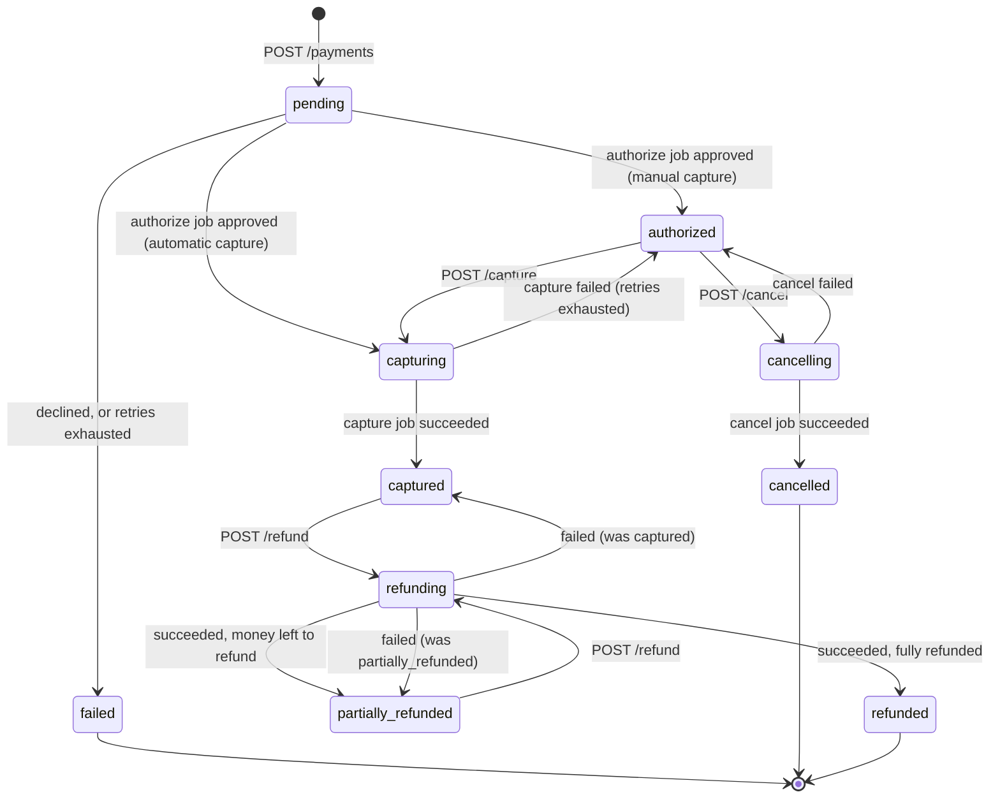
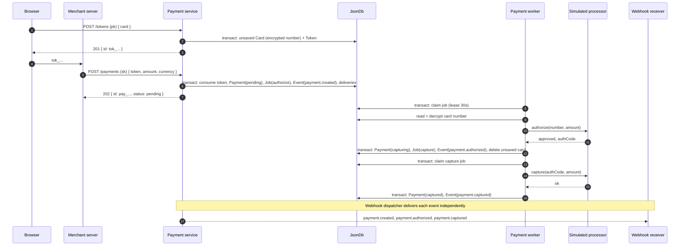
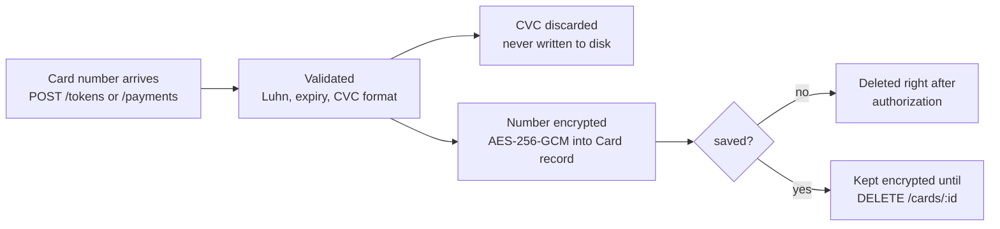
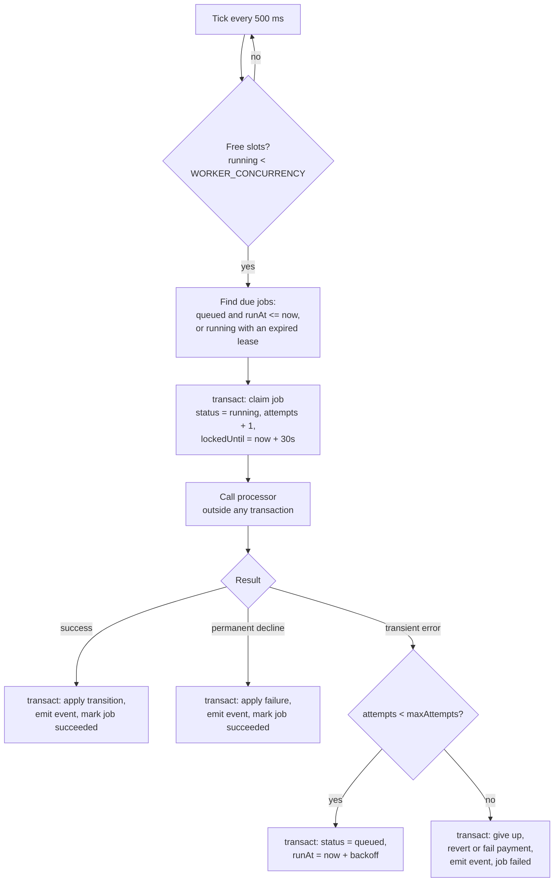

# 3. Payment Lifecycle

## 3.1 Why everything is asynchronous

Real card networks are slow and unreliable. They time out, rate-limit and have outages. If an HTTP request waited for the processor:

- the client's connection would stay open for the whole processor call, and might time out, leaving the client unsure whether it was charged;
- a processor outage would turn directly into failed API requests;
- retrying a failed processor call would mean the *client* has to retry the whole request.

So every operation that talks to the processor (**authorize, capture, refund, cancel**) is **queued as a job**, and the API responds immediately with `202 Accepted`. A background worker does the slow part, retries temporary failures itself, and reports the outcome through webhooks and the payment's `status`.

## 3.2 State machine



`failed`, `cancelled` and `refunded` are **terminal**: no further actions are possible.

### Allowed actions per status

| Status | capture | refund | cancel | PATCH (description/metadata) |
|---|:-:|:-:|:-:|:-:|
| `pending` | ✗ | ✗ | ✗ | ✓ |
| `authorized` | ✓ | ✗ | ✓ | ✓ |
| `capturing` / `refunding` / `cancelling` | ✗ | ✗ | ✗ | ✓ |
| `captured` | ✗ | ✓ | ✗ | ✓ |
| `partially_refunded` | ✗ | ✓ | ✗ | ✓ |
| `failed` / `cancelled` / `refunded` | ✗ | ✗ | ✗ | ✓ |

A disallowed action returns `409 invalid_state`, with a message naming the current status.

| Rule | Why |
|---|---|
| **No cancel while `pending`** | The worker may already be talking to the processor. Allowing cancel here would create a race between "cancelled" and "authorized". The client waits for `authorized`, then cancels |
| **No actions while an action is in flight** | Prevents, for example, two refunds that together exceed the captured amount. One pending action at a time makes the amount checks reliable |
| **PATCH is always allowed** | Description and metadata are the merchant's own labels. They don't affect money, so there's no reason to lock them |
| **Status can only change through actions** | `PATCH` can't set `status` or `amount`, so nobody can bypass the state machine |
| **Partial capture releases the rest** | Matches how card networks behave: one capture per authorization. Capturing $6 of a $10 authorization leaves $4 that can't be captured later |

### Amount rules

| Action | `amount` | Rule |
|---|---|---|
| capture | optional, defaults to the full `amount` | `1 ≤ amount ≤ payment.amount` |
| refund | optional, defaults to everything still refundable | `1 ≤ amount ≤ amountCaptured − amountRefunded` |

**Why the amount checks happen when the request is made (not in the worker):** the client gets an immediate `400` for an impossible amount, instead of an accepted request that fails a few seconds later.

## 3.3 Creating a payment

A payment needs a card from **exactly one** of three sources:

| Source | Field | Typical caller | Notes |
|---|---|---|---|
| Token | `token: "tok_…"` | Merchant server, after the browser tokenized the card with the `pk` | **Recommended.** The raw card number never touches the merchant's server |
| Saved card | `cardId: "card_…"` | Merchant server, for a returning customer | No CVC is needed: it was checked when the card was saved, and it's never stored (see [Security §4.5](04-security.md#45-cvc)) |
| Raw card | `card: { number, expMonth, expYear, cvc }` | Merchant server (secret key only) | For server-side testing and simple integrations |

`saveCard: true` (with a `token` or `card`) also saves the card to the vault, tagged with `customerId` if one is given.

**Why three sources instead of tokens only:** tokens are the secure default for real checkouts, but requiring them for every test would mean two calls per payment. Raw cards are allowed **only with the secret key**, so the browser-facing publishable key can never create payments directly.



### What happens to the card number



## 3.4 The payment worker

### Loop



| Decision | Why |
|---|---|
| **Claim and apply in separate transactions; processor call outside both** | A transaction blocks every other write (see [Persistence](07-persistence.md#isolation)). Holding one open during a 300 ms processor call would stall the whole API |
| **Lease of 30 s** | If the process dies mid-job, the job becomes claimable again after 30 s. Nothing gets stuck forever |
| **Check ownership when applying** | The apply step checks that the job is still `running` with the same `attempts` number. If the lease expired and another run took over, the stale result is thrown away, so a transition is never applied twice |
| **Declines count as job success** | A decline is a valid *answer* from the processor, not a failure to get one, so retrying wouldn't change it. Only **transient** errors are retried |
| **Concurrency limit (default 5)** | Bounds memory use and the number of simultaneous processor calls |

### Retry schedule (transient errors)

| Attempt | Delay before it |
|---|---|
| 1 | immediately |
| 2 | 2 s |
| 3 | 4 s |
| 4 | 8 s |
| 5 | 16 s |

That's exponential backoff, `2^(attempt-1)` seconds, with up to 5 attempts in about 30 s.

**Why exponential backoff:** if the processor is overloaded, retrying straight away adds to the load. Waiting longer each time gives it room to recover.

### When retries run out

| Job type | Payment ends up | Event |
|---|---|---|
| authorize | `failed` with `failure.code = "processing_error"` | `payment.failed` |
| capture / refund / cancel | Back to `pendingAction.previousStatus` | `payment.action_failed` (includes which action failed and why) |

**Why revert instead of failing the payment:** a failed *refund* doesn't change the fact that the money was captured. Marking the payment `failed` would misrepresent where the money is. Reverting tells the truth: the action didn't happen, and the merchant can try again.

### At-least-once execution

Because of leases and retries, a job can occasionally **run more than once**, for example when the process crashes after calling the processor but before committing the result. Every processor call carries the `job.id` as an idempotency reference, so a real gateway would recognise the repeat. The simulated processor accepts it and stays consistent.

**Why not exactly-once:** exactly-once across a network call is impossible to guarantee in general. The standard, honest approach is at-least-once execution plus idempotent operations.

## 3.5 Simulated processor

The processor is a stand-in for a card network. It's deterministic, so every path can be tested on demand.

### Test cards

Any card number that passes the Luhn check and isn't listed below is **approved**.

| Card number | Result | Kind |
|---|---|---|
| `4242 4242 4242 4242` | Approved (Visa) | – |
| `5555 5555 5555 4444` | Approved (Mastercard) | – |
| `4000 0000 0000 0002` | `card_declined` | Permanent |
| `4000 0000 0000 9995` | `insufficient_funds` | Permanent |
| `4000 0000 0000 0069` | `expired_card` | Permanent |
| `4000 0000 0000 0127` | `incorrect_cvc` | Permanent |
| `4000 0000 0000 0119` | `processing_error` | **Transient**: retried until attempts run out, then `failed` |
| Any card with a past expiry date | `expired_card` | Permanent |

**Why these numbers:** they follow the widely used Stripe test-card convention, so they're familiar to anyone who has integrated a payment API, and they pass the Luhn check.

### Behaviour knobs

| Setting | Effect | Why it exists |
|---|---|---|
| `PROCESSOR_LATENCY_MS` (300) | Every call waits this long | Makes the async flow visible: you can watch `pending` change to `captured` |
| `PROCESSOR_FAILURE_RATE` (0) | Probability that **any** call (including capture, refund, cancel) returns a transient error | The only way to exercise the retry and revert paths for capture, refund and cancel, which otherwise always succeed |

### Interface

```ts
interface Processor {
  authorize(input: { reference: string; cardNumber: string; expMonth: number; expYear: number;
                     amount: number; currency: string }): Promise<ProcessorResult<{ authorizationCode: string }>>;
  capture(input: { reference: string; authorizationCode: string; amount: number }): Promise<ProcessorResult>;
  refund(input:  { reference: string; authorizationCode: string; amount: number }): Promise<ProcessorResult>;
  cancel(input:  { reference: string; authorizationCode: string }): Promise<ProcessorResult>;
}

type ProcessorResult<T = {}> =
  | ({ outcome: 'success' } & T)
  | { outcome: 'declined'; code: string; message: string }    // permanent
  | { outcome: 'error'; code: string; message: string };      // transient, retry
```

**Why an interface:** the worker depends on this interface, not on the simulator. A real gateway adapter could be added later without touching the worker.
