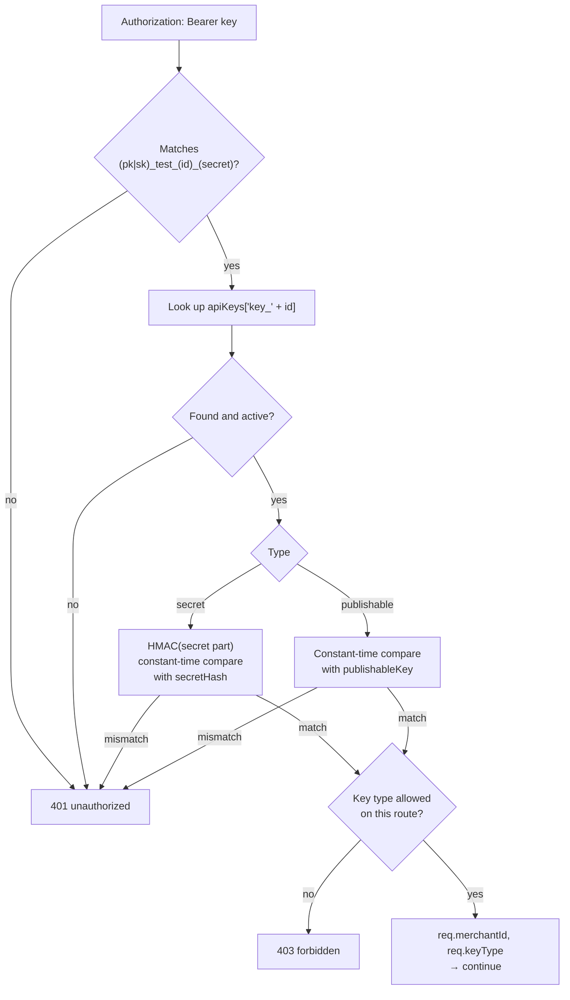
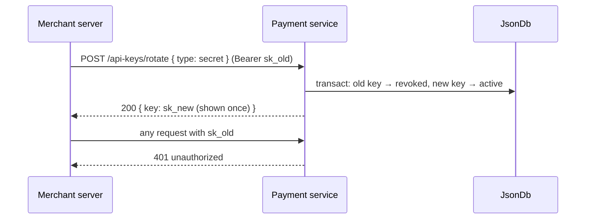
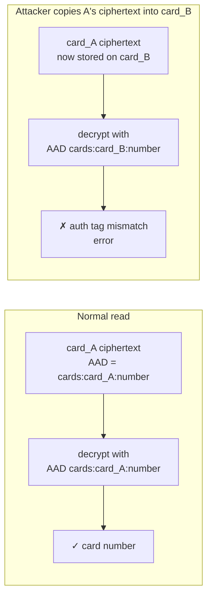

# 4. Security

## 4.1 Threat model

Being explicit about the threats explains *why* each control exists.

| # | Threat | Main control |
|---|---|---|
| T1 | The `db.json` file is copied or leaked (backup, stolen disk, misconfigured server) | Field-level encryption and hashing: the file alone reveals no usable secrets or card numbers |
| T2 | A publishable key is extracted from a website's JavaScript | Publishable keys can **only** create tokens. They can't read data or move money |
| T3 | A secret key leaks | Rotation revokes it **immediately**. Merchants are isolated, so the damage is limited to one merchant |
| T4 | Someone with write access edits `db.json` to swap encrypted values between records | AAD binds each ciphertext to its record and field (§4.4) |
| T5 | A forged or replayed webhook hits a merchant's receiver | HMAC signature including a timestamp (§4.7) |
| T6 | A webhook URL points at internal infrastructure (SSRF) | URL validation and blocking private IPs (§4.8) |
| T7 | Merchant A tries to read merchant B's data | Every query is filtered by `merchantId`; other merchants' IDs return 404 |
| T8 | Flooding of the open sign-up or token endpoints | Rate limiting (§4.9) |
| T9 | Secrets end up in logs | Redaction (§4.10) |

**Out of scope:** attackers who can read the process memory or the environment variables (they'd have the master keys), and TLS termination, which should be done by a reverse proxy in front of the service.

## 4.2 Key types

| Key | Format | Lives in | Can do | Stored as |
|---|---|---|---|---|
| Publishable | `pk_test_<16 hex id>_<43 random chars>` | Browser / mobile app | `POST /tokens` **only** | Plain text |
| Secret | `sk_test_<16 hex id>_<43 random chars>` | Merchant's server | Everything except sign-up | HMAC-SHA256 hash |
| Webhook signing secret | `whsec_<43 random chars>` | Merchant's webhook receiver | Verify webhook signatures | AES-256-GCM ciphertext |

**Why three separate secrets:** each one does one job and lives in one place. If any of them leaks, the damage is limited to that job:

- a leaked `pk` can create tokens, nothing more;
- a leaked `whsec` lets someone forge webhooks to that one endpoint, but **not** call the API. This is why a webhook receiver can run as an independent service that never holds the `sk`;
- only a leaked `sk` is serious, and it can be revoked instantly.

The random part is 32 bytes from `crypto.randomBytes`, base64url-encoded (43 characters), which gives **256 bits of entropy**: far beyond brute-force range.

## 4.3 API keys

### Authentication flow



| Decision | Why |
|---|---|
| **HMAC-SHA256 with a server secret**, not bcrypt/argon2 | bcrypt/argon2 are deliberately slow so that guessing **low-entropy passwords** is expensive. Our keys are 256-bit random values, impossible to guess anyway, so a slow hash would only add ~100 ms to **every** request. The HMAC secret ("pepper") also means a leaked file can't even be used to *check* guesses offline |
| **Constant-time comparison** (`crypto.timingSafeEqual`) | A normal `===` stops at the first wrong character. Measuring response times could let an attacker learn the hash one character at a time |
| **Same 401 for every failure** (unknown, revoked, wrong secret, malformed) | Different errors would tell an attacker which key IDs exist |
| **ID embedded in the key** | Finds the record directly, so authentication doesn't scan every stored hash |

### API key rotation

`POST /api-keys/rotate` with `{ "type": "secret" | "publishable" }`:



| Decision | Why |
|---|---|
| **Immediate revocation, no grace period** | The usual reason to rotate is suspected exposure, and a grace period would leave a possibly compromised key working. The trade-off: the merchant must deploy the new key straight away, so any server still using the old one fails until it's updated |
| **No forced or scheduled rotation** | The merchant decides when to rotate. Forced expiry would cause outages the merchant didn't plan for |
| **Revoke and create in one transaction** | A merchant is never left with zero active keys or two active keys of the same type, even if the process crashes mid-rotation |
| **Rotation requires the secret key** | A publishable key is public, so it must not be able to replace keys |
| **No standalone "revoke" endpoint** | Revoking without a replacement would lock the merchant out, and with open sign-up there's no account login to recover access. Rotation is "revoke + replace" in one step |

## 4.4 Encryption at rest (AES-256-GCM)

### What is protected, and how

| Data | Treatment | Why this treatment |
|---|---|---|
| Card number | **Encrypted** | The worker must recover it to authorize |
| Webhook signing secret | **Encrypted** | The dispatcher must recover it to sign every delivery |
| Secret API key | **Hashed** (HMAC) | Only ever *compared*, never needed in its original form, so it's safest not to keep a recoverable copy |
| Card fingerprint | **Hashed** (HMAC) | Only needed to test "same card?" |
| CVC | **Never stored** | See §4.5 |
| Brand, last 4, expiry | Plain text | Not sensitive on their own; needed for display |

**Rule of thumb:** if we only need to *check* a value, **hash** it. If we need to *use* it, **encrypt** it. If we don't need it after the request, **don't store it**.

**Why AES-256-GCM:** it's *authenticated* encryption. Besides hiding the data, it detects any change to the ciphertext. It's the industry default, built into Node's `crypto`, and hardware-accelerated on modern CPUs.

**Why field-level and not whole-file encryption:** it keeps the rest of the JSON readable for debugging, means only the sensitive fields pay the decryption cost, and keeps a card number encrypted even when the surrounding record is loaded into memory or logged by mistake.

### Stored format

```
v1:mZ3x9Qk1aB7cR2pL:Xw8Jd0sYc4Fq3kVt9LmN2A==:Hk29dLx0P1q…
│  │                │                        └ ciphertext (base64)
│  │                └ auth tag, 16 bytes (base64): integrity check
│  └ IV / nonce, 12 bytes (base64): random for every encryption
└ key version: which master key was used
```

| Part | Secret? | Why it's stored |
|---|---|---|
| Key version | No | Lets several master keys exist at once, so keys can be rotated (below) |
| IV (nonce) | No | GCM needs it to decrypt. It must be **unique per encryption** under the same key, because reusing one breaks GCM's security. It's generated randomly every time |
| Auth tag | No | Proves the ciphertext wasn't modified. Decryption fails instead of returning corrupted data |
| Ciphertext | Yes | The encrypted value. Unreadable without the master key |

**Why one colon-separated string:** it fits in a single JSON field, carries everything needed to decrypt it, and can't end up with a mismatched IV and tag the way two separate fields could.

### AAD: binding ciphertext to its record

**AAD (Additional Authenticated Data)** is extra context that is *not* encrypted but is mixed into the auth tag. Decryption only succeeds if exactly the same AAD is supplied again.

The service uses `<collection>:<recordId>:<field>` as the AAD, for example `cards:card_9f2e…:number`.



**Why:** without AAD, someone who can edit `db.json` but doesn't have the key could still *move* a valid ciphertext, for example making their own saved card charge a victim's card number. AAD makes every ciphertext valid **only in the place it was created for**. It also stops a webhook-secret ciphertext from ever decrypting as a card number.

### Master keys and their rotation

```
ENCRYPTION_KEYS=v1:<base64 32 bytes>,v2:<base64 32 bytes>
ENCRYPTION_ACTIVE_KEY_ID=v2
```

- **Encrypt** always uses the active key and writes its version into the prefix.
- **Decrypt** reads the prefix and picks the matching key.

To rotate the master key:

1. Generate a new key (`yarn gen:secrets`) and add it as `v2` **alongside** `v1`.
2. Set `ENCRYPTION_ACTIVE_KEY_ID=v2` and restart. New data uses `v2`, and old data still decrypts with `v1`.
3. Run `yarn reencrypt` (with the service stopped) to rewrite every `v1` ciphertext as `v2`.
4. Remove `v1` from `ENCRYPTION_KEYS`.

**Why versioning:** without it, a new master key would make every existing ciphertext unreadable, so rotation would require downtime and a risky "big bang" migration.

### The hashing secret

`HASHING_SECRET` is used through **HKDF** (a standard function for deriving separate keys from one secret) to produce two independent sub-keys:

| Sub-key (HKDF label) | Used for |
|---|---|
| `api-key-hash` | `secretHash` of secret API keys |
| `card-fingerprint` | `Card.fingerprint` |

**Why derive sub-keys:** one secret to manage, but each purpose gets its own key (*domain separation*), so a fingerprint can never be confused with or substituted for a key hash.

**Why fingerprint with HMAC instead of comparing ciphertexts:** GCM uses a random IV, so encrypting the same card twice gives two different ciphertexts. A keyed hash is deterministic, which makes equality checks possible. Being keyed, it also can't be brute-forced from a leaked file (card numbers have little enough entropy that a plain SHA-256 could be).

⚠️ **`HASHING_SECRET` can't be rotated without impact:** changing it invalidates every secret API key (merchants must rotate) and every fingerprint (duplicate detection restarts). Generate it once and protect it like a master key.

## 4.5 CVC

The CVC is checked for format (3–4 digits) when the request arrives, then **dropped**. It's never written to the database, logs or job payloads.

**Why:** PCI DSS explicitly forbids storing "sensitive authentication data" such as the CVC after authorization, even encrypted. Its whole purpose is to prove the cardholder has the physical card *right now*; a stored copy defeats that. This is also why charging a **saved card** doesn't ask for a CVC.

## 4.6 Merchant isolation

- Every module function takes the authenticated `merchantId` as its first argument.
- Data access goes through **scoped** database calls: `db.read(merchantId, …)` / `db.transact(merchantId, …)` (see [Persistence §7.2](07-persistence.md#72-interface-scoped-transactions)). The callback receives **only that merchant's subtree** of the database.
- Looking up another merchant's ID therefore finds nothing, and the response is exactly the same as for a missing record: **404**.

**Why structural isolation instead of `record.merchantId === merchantId` checks:** a check has to be written in every lookup, and a single forgotten one leaks data. With scoped access there's nothing to forget: other merchants' records simply aren't reachable from the callback.

**Why enforce this in the module layer and not only in routes:** the workers and any future routes then get the same guarantee automatically. No caller can forget the scope, because it's part of the function signature.

## 4.7 Webhook signatures

Each delivery carries:

```
Webhook-Id: evt_…
Webhook-Event: payment.captured
Webhook-Signature: t=1760520600,v1=5257a869e7…
```

`v1 = hex(HMAC-SHA256(whsec, "<t>.<raw request body>"))`

| Decision | Why |
|---|---|
| Sign the **raw body** | Re-serializing JSON can change whitespace or key order and break the signature. Receivers must verify the bytes they received |
| Include a timestamp `t` | Receivers reject signatures older than 5 minutes, so a captured request can't be **replayed** days later |
| Version prefix `v1=` | The signing scheme can change later without breaking receivers that only understand `v1` |
| One secret per endpoint | Leaking one receiver's secret doesn't affect the others |
| Secret rotation is immediate | Same reasoning as API keys. Deliveries signed with the new secret fail on the receiver until it's updated |

A verification example is in [Webhooks](06-webhooks.md#66-verifying-signatures).

## 4.8 SSRF protection for webhook URLs

A webhook URL makes **our server** send requests to an address the merchant chose. Without checks, a merchant could point it at `http://169.254.169.254/` (cloud metadata) or `http://localhost:6379/` (internal services). This attack is called server-side request forgery (SSRF).

Rules, checked when an endpoint is **registered** and again **before every delivery**:

1. The scheme must be `https`.
2. The hostname is resolved, and **every** resulting IP must be public. Rejected: loopback (`127.0.0.0/8`, `::1`), private (`10/8`, `172.16/12`, `192.168/16`, `fc00::/7`), link-local (`169.254/16`, `fe80::/10`), `0.0.0.0`, and multicast.
3. Redirects are **not followed**. A 3xx response counts as a failed attempt.
4. Timeout of 10 s, and response bodies are ignored beyond 1 KB.

| Decision | Why |
|---|---|
| Check again at delivery time | DNS can change after registration (*DNS rebinding*): a hostname that pointed to a public IP can later point to an internal one |
| Don't follow redirects | A public URL could redirect to an internal one, bypassing rule 2 |
| `WEBHOOK_ALLOW_INSECURE_URLS=true` to relax rules 1–2 | Local development needs `http://localhost:4000/webhooks`. It's an explicit opt-in, so it can't be turned on by accident |

## 4.9 Rate limiting

In-memory limits per window:

| Route | Limit | Keyed by | Why |
|---|---|---|---|
| `POST /merchants` | 5 / hour | Client IP | Sign-up is open and unauthenticated (see the [README](README.md#intentional-decision-open-merchant-sign-up)). This stops trivial mass account creation |
| `POST /tokens` | 60 / minute | API key | Publishable keys are public, so anyone can call this. The limit stops using the endpoint to test stolen card numbers (*card testing*) |
| Everything else | 300 / minute | API key | General protection against runaway clients |

**Why in-memory:** the service is a single process (see [Persistence](07-persistence.md#710-limitations)), so there's no need for a shared store like Redis. Limits reset on restart, which is acceptable for a simulator.

## 4.10 Logging and redaction

Never logged:
- the `Authorization` header;
- request or response bodies of `/tokens`, `/cards`, `/payments` (they may contain card numbers), `/merchants` and `/api-keys/rotate` (they contain new keys), and `/webhooks` creation and rotation (they contain signing secrets);
- decrypted values of any kind.

Logged: method, route pattern, status, duration, `merchantId`, key **ID** (not the key), and request ID. 5xx errors also log the redacted error and its stack.

**Why an allow-list of fields instead of trying to strip secrets:** stripping depends on knowing every place a secret can appear, and forgetting one leaks it. Logging only known-safe fields fails safe.

**And redaction as a safety net anyway:** secrets sometimes end up where nobody expected, such as inside a third-party exception message. Every value written to the log first goes through `redact()`, which masks sensitive keys and anything that *looks like* a key, webhook secret, card number or ciphertext, including inside error messages and stack traces. Error responses never contain exception messages or echoed input. See [Error handling §8.4](08-error-handling.md#84-what-the-client-receives) and [§8.7](08-error-handling.md#87-redaction-the-safety-net).

## 4.11 File permissions

The database directory is created with mode `0o700` and the file with `0o600`. On Linux and macOS, that means **only the OS user running the service** can read or write them.

```ts
await mkdir(dir, { recursive: true, mode: 0o700 });
const handle = await open(tmpFile, 'w', 0o600);
```

**How this behaves on each OS (no OS-specific code):**

| OS | Effect |
|---|---|
| Linux / macOS | Applied. Owner read/write only. The mode is applied on every write, because each write creates a new temp file |
| Windows | **Silently ignored**: Node doesn't throw. Windows controls access with ACLs instead. Files inherit the ACL of their folder, so keep the data directory somewhere only the service account can access (e.g. under its user profile), or lock it down once: `icacls data /inheritance:r /grant:r "%USERNAME%:(OI)(CI)F"` |

**Why there's no OS detection in the code:** file permissions are a *second* layer of protection. The main protection, field-level encryption and hashing, works the same on every OS. Passing the mode is harmless where it isn't supported, so a platform check would add code without adding security. The Windows step is a one-time deployment instruction.

## 4.12 Transport

The service listens on plain HTTP and expects a **reverse proxy** (nginx, Caddy, a cloud load balancer) to terminate TLS in front of it.

**Why:** certificate management, renewal and TLS configuration are better handled by tools built for it, and it keeps the service simple. **Never expose the service directly to the internet over plain HTTP**: API keys and card numbers travel in requests.
