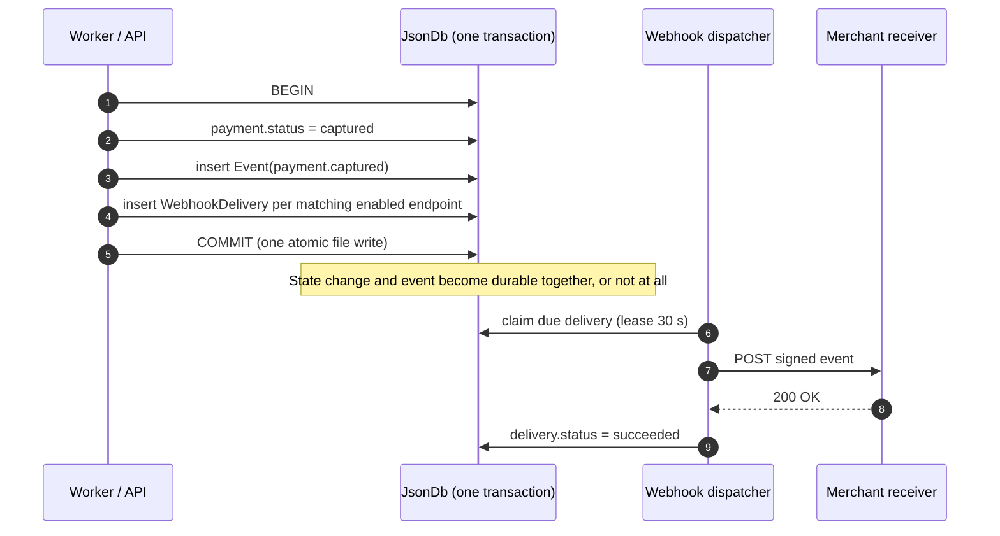
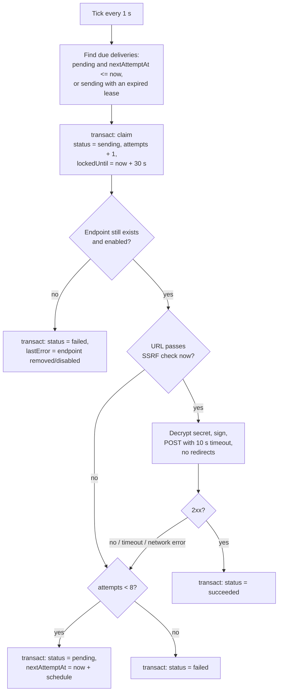

# 6. Webhooks

Webhooks tell a merchant's server that something happened, so it doesn't have to keep polling. Because payments are processed asynchronously (see [Lifecycle](03-payment-lifecycle.md#31-why-everything-is-asynchronous)), webhooks are the **main way** a merchant learns the outcome of a payment.

## 6.1 Event types

| Event | Emitted when | Payment status afterwards |
|---|---|---|
| `payment.created` | `POST /payments` accepted | `pending` |
| `payment.authorized` | Processor approved the authorization | `authorized` or `capturing` |
| `payment.captured` | Capture completed | `captured` |
| `payment.partially_refunded` | A refund completed, money still left | `partially_refunded` |
| `payment.refunded` | A refund completed, fully refunded | `refunded` |
| `payment.cancelled` | Cancellation completed | `cancelled` |
| `payment.failed` | Authorization declined, or retries exhausted | `failed` |
| `payment.action_failed` | A capture/refund/cancel permanently failed, and the payment reverted | the previous status |
| `payment.updated` | Description or metadata changed via `PATCH` | unchanged |

**Why no events for `capturing` / `refunding` / `cancelling`:** the merchant's own API call caused those transitions and already received the `202` response confirming them. An event would just repeat what the merchant already knows. Events are for outcomes the merchant *can't* know without being told.

## 6.2 Payload

```http
POST /webhooks/payments HTTP/1.1
Host: acme.test
Content-Type: application/json
User-Agent: payment-service-webhooks/1.0
Webhook-Id: evt_44c2…
Webhook-Event: payment.captured
Webhook-Signature: t=1760520600,v1=5257a869e7ecebeda32affa62cdca3fa51cad7e77a0e56ff536d0ce8e108d8bd

{
  "id": "evt_44c2…",
  "type": "payment.captured",
  "createdAt": "2026-10-15T09:30:00.000Z",
  "data": { "object": { "id": "pay_3f9c…", "status": "captured", "amount": 2500, "…": "…" } }
}
```

`data.object` is the [payment object](05-api.md#payment-object) **as it was when the event happened**.

**Why include the whole payment instead of just its ID:** most receivers can act on the event without calling the API back, which saves a round trip and keeps working even if the receiver doesn't hold a secret key (see [Security §4.2](04-security.md#42-key-types)).

## 6.3 The outbox: how events are never lost

The central guarantee: **if a payment's state changed, an event for it exists, and vice versa.** This holds because the event and its deliveries are written in the **same transaction** as the state change. This is the *transactional outbox* pattern.



**Why not send the webhook straight from the code that changed the payment:**

| Alternative | What goes wrong |
|---|---|
| Send the HTTP request, *then* commit | If the commit fails, the merchant was told about a change that never happened |
| Commit, *then* send the HTTP request | If the process crashes in between, the event is lost forever |
| Outbox (chosen) | The event is committed together with the change, and sending happens later, with retries |

### Fan-out

When an event is recorded, one delivery is created **for each enabled endpoint of that merchant whose `events` list includes the event type** (or is `["*"]`). If no endpoint matches, the event is still stored (for `GET /events`) but no deliveries are created.

**Why fan out at write time instead of at send time:** the set of receivers is fixed at the moment the event happened. An endpoint added *later* doesn't suddenly receive old events, and one disabled later still gets what was already queued for it.

## 6.4 Dispatcher



### Retry schedule

| Attempt | Sent at (after the event) |
|---|---|
| 1 | immediately |
| 2 | + 1 min |
| 3 | + 5 min |
| 4 | + 30 min |
| 5 | + 2 h |
| 6 | + 6 h |
| 7 | + 12 h |
| 8 | + 24 h |

The delays are measured from the previous attempt, so retries span about 45 hours in total.

**Why such a long schedule:** a receiver might be down for a deployment, an outage or a weekend. Spreading retries over almost two days gives it time to recover without hammering it in the meantime. The 7-day retention (`RETENTION_DAYS`) comfortably covers the full schedule.

**Why any non-2xx counts as a failure (including 3xx):** following redirects would allow SSRF (see [Security §4.8](04-security.md#48-ssrf-protection-for-webhook-urls)), and a 4xx often comes from a temporary misconfiguration on the receiver's side that gets fixed. Retrying is cheap, and the receiver can always ignore duplicates.

## 6.5 Delivery guarantees

| Property | Guarantee | What receivers should do |
|---|---|---|
| **At least once** | Every event is delivered at least once, unless all 8 attempts fail | Store processed `Webhook-Id`s and skip any already seen |
| **No ordering** | Events for the same payment may arrive **out of order**, e.g. a retried `payment.authorized` landing after `payment.captured` | Compare `data.object.updatedAt` with what you've stored and ignore older snapshots, or re-fetch `GET /payments/:id` |
| **Independent endpoints** | One failing endpoint never delays another | – |

**Why not guarantee order:** strict ordering would mean one failed delivery blocks every later event for that merchant until it succeeds, so one bad response could stall all of a merchant's webhooks for up to 45 hours. Including a full snapshot with `updatedAt` lets receivers sort it out themselves cheaply.

**Why not exactly-once:** the dispatcher can't know whether the receiver processed a request whose response got lost on the network. At-least-once plus deduplication on the receiver's side is the standard, honest approach.

## 6.6 Verifying signatures

The receiver needs **only** the endpoint's `whsec_` secret, not an API key. This is what lets a webhook consumer run as an independent service.

Steps:

1. Read the **raw** request body (before any JSON parsing).
2. Parse `Webhook-Signature` into `t` and `v1`.
3. Reject if `|now − t| > 300` seconds (replay protection).
4. Compute `HMAC-SHA256(secret, t + "." + rawBody)` as hex.
5. Compare with `v1` in **constant time**.

```ts
import { createHmac, timingSafeEqual } from 'node:crypto';
import express from 'express';

const WEBHOOK_SECRET = process.env.WEBHOOK_SECRET!; // whsec_…
const TOLERANCE_SECONDS = 300;

export function verifySignature(rawBody: Buffer, header: string | undefined, secret: string): boolean {
  if (!header) return false;
  const parts = Object.fromEntries(header.split(',').map((p) => p.split('=') as [string, string]));
  const timestamp = Number(parts.t);
  if (!Number.isInteger(timestamp) || !parts.v1) return false;
  if (Math.abs(Date.now() / 1000 - timestamp) > TOLERANCE_SECONDS) return false;

  const expected = createHmac('sha256', secret).update(`${timestamp}.`).update(rawBody).digest();
  const received = Buffer.from(parts.v1, 'hex');
  return received.length === expected.length && timingSafeEqual(received, expected);
}

const app = express();

// express.raw keeps the exact bytes; express.json would re-serialize and break the signature.
app.post('/webhooks/payments', express.raw({ type: 'application/json' }), (req, res) => {
  if (!verifySignature(req.body, req.get('Webhook-Signature'), WEBHOOK_SECRET)) {
    return res.status(400).send('invalid signature');
  }
  const event = JSON.parse(req.body.toString('utf8'));
  // 1. Skip if event.id was already processed (at-least-once delivery).
  // 2. Queue your own work and return 2xx quickly (we time out after 10 s).
  res.sendStatus(200);
});
```

## 6.7 Receiver checklist

- [ ] Verify the signature on the **raw** body.
- [ ] Reject timestamps older than 5 minutes.
- [ ] Deduplicate by `Webhook-Id`.
- [ ] Don't rely on arrival order. Use `data.object.updatedAt`.
- [ ] Respond `2xx` within 10 seconds, and do slow work asynchronously.
- [ ] Use `GET /events` to reconcile after downtime.
