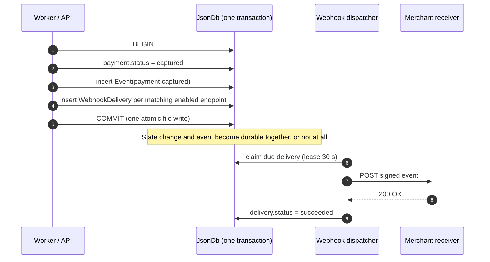
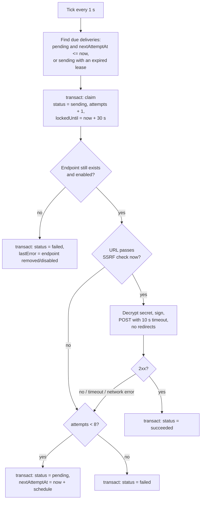

# 6. Webhooks

Webhooks tell a merchant's server that something happened, so it doesn't have to keep polling. Because payments are processed asynchronously (see [Lifecycle](03-payment-lifecycle.md#31-why-everything-is-asynchronous)), webhooks are the **main way** a merchant learns the outcome of a payment.

## 6.1 Event types

| Event | Emitted when | Payment status afterwards |
|---|---|---|
| `payment.created` | `POST /payments` accepted | `pending` |
| `payment.authorized` | Processor approved the authorization | `authorized` or `capturing` |
| `payment.captured` | Capture completed | `captured` |
| `payment.partially_refunded` | A refund completed, money still left | `partially_refunded` |
| `payment.refunded` | A refund completed, fully refunded | `refunded` |
| `payment.cancelled` | Cancellation completed | `cancelled` |
| `payment.failed` | Authorization declined, or retries exhausted | `failed` |
| `payment.action_failed` | A capture/refund/cancel permanently failed, and the payment reverted | the previous status |
| `payment.updated` | Description or metadata changed via `PATCH` | unchanged |

**Why no events for `capturing` / `refunding` / `cancelling`:** the merchant's own API call caused those transitions and already received the `202` response confirming them. An event would just repeat what the merchant already knows. Events are for outcomes the merchant *can't* know without being told.

## 6.2 Payload

```http
POST /webhooks/payments HTTP/1.1
Host: localhost:4000
Content-Type: application/json
User-Agent: payment-service-webhooks/1.0
Webhook-Id: evt_44c2…
Webhook-Event: payment.captured
Webhook-Signature: t=1760520600,v1=5257a869e7ecebeda32affa62cdca3fa51cad7e77a0e56ff536d0ce8e108d8bd

{
  "id": "evt_44c2…",
  "type": "payment.captured",
  "createdAt": "2026-10-15T09:30:00.000Z",
  "data": { "object": { "id": "pay_3f9c…", "status": "captured", "amount": 2500, "…": "…" } }
}
```

`data.object` is the [payment object](05-api.md#payment-object) **as it was when the event happened**.

**Why include the whole payment instead of just its ID:** most receivers can act on the event without calling the API back, which saves a round trip and keeps working even if the receiver doesn't hold a secret key (see [Security §4.2](04-security.md#42-key-types)).

## 6.3 The outbox: how events are never lost

The central guarantee: **if a payment's state changed, an event for it exists, and vice versa.** This holds because the event and its deliveries are written in the **same transaction** as the state change. This is the *transactional outbox* pattern.



**Why not send the webhook straight from the code that changed the payment:**

| Alternative | What goes wrong |
|---|---|
| Send the HTTP request, *then* commit | If the commit fails, the merchant was told about a change that never happened |
| Commit, *then* send the HTTP request | If the process crashes in between, the event is lost forever |
| Outbox (chosen) | The event is committed together with the change, and sending happens later, with retries |

### Fan-out

When an event is recorded, one delivery is created **for each enabled endpoint of that merchant whose `events` list includes the event type** (or is `["*"]`). If no endpoint matches, the event is still stored (for `GET /events`) but no deliveries are created.

**Why fan out at write time instead of at send time:** the set of receivers is fixed at the moment the event happened. An endpoint added *later* doesn't suddenly receive old events, and one disabled later still gets what was already queued for it.

## 6.4 Dispatcher



### Retry schedule

| Attempt | Sent at (after the event) |
|---|---|
| 1 | immediately |
| 2 | + 1 min |
| 3 | + 5 min |
| 4 | + 30 min |
| 5 | + 2 h |
| 6 | + 6 h |
| 7 | + 12 h |
| 8 | + 24 h |

The delays are measured from the previous attempt, so retries span about 45 hours in total.

**Why such a long schedule:** a receiver might be down for a deployment, an outage or a weekend. Spreading retries over almost two days gives it time to recover without hammering it in the meantime. The 7-day retention (`RETENTION_DAYS`) comfortably covers the full schedule.

**Why any non-2xx counts as a failure (including 3xx):** following redirects would allow SSRF (see [Security §4.8](04-security.md#48-ssrf-protection-for-webhook-urls)), and a 4xx often comes from a temporary misconfiguration on the receiver's side that gets fixed. Retrying is cheap, and the receiver can always ignore duplicates.

## 6.5 Delivery guarantees

| Property | Guarantee | What receivers should do |
|---|---|---|
| **At least once** | Every event is delivered at least once, unless all 8 attempts fail | Store processed `Webhook-Id`s and skip any already seen |
| **No ordering** | Events for the same payment may arrive **out of order**, e.g. a retried `payment.authorized` landing after `payment.captured` | Compare `data.object.updatedAt` with what you've stored and ignore older snapshots, or re-fetch `GET /payments/:id` |
| **Independent endpoints** | One failing endpoint never delays another | – |

**Why not guarantee order:** strict ordering would mean one failed delivery blocks every later event for that merchant until it succeeds, so one bad response could stall all of a merchant's webhooks for up to 45 hours. Including a full snapshot with `updatedAt` lets receivers sort it out themselves cheaply.

**Why not exactly-once:** the dispatcher can't know whether the receiver processed a request whose response got lost on the network. At-least-once plus deduplication on the receiver's side is the standard, honest approach.

## 6.6 Receiving and verifying webhooks

### Step by step: receive your first webhook locally

**The URL is your choice: any host, port and path, such as `/webhooks/payments` or `/api/pms/payment`.** The one rule is that **the URL you register must be exactly the address your receiver handles.** The service POSTs to exactly that URL, and a receiver answers `404` for any path it doesn't handle. A mismatch is the most common reason deliveries fail. The examples below use `http://localhost:4000/webhooks/payments`.

**1. Start the payment service with insecure webhook URLs allowed** (local development only):

```bash
# in .env
WEBHOOK_ALLOW_INSECURE_URLS=true
```

```bash
yarn dev
```

Without this setting, registering an `http://` or `localhost` URL is rejected with `400` ("must use https", or "must not point to a private, loopback or reserved address"). That's the SSRF protection from [Security §4.8](04-security.md#48-ssrf-protection-for-webhook-urls). **Never enable it in production.**

**2. Start a receiver.** The [README walkthrough (step 2)](../README.md#manual-walkthrough-curl) has a short receiver script you can paste into a terminal. It prints the URL it listens on, for example:

```
Receiver listening on http://localhost:4000/webhooks/payments
```

To use a different path or port, start it with `WEBHOOK_PATH=/api/pms/payment PORT=5000`. If the port is already taken (`EADDRINUSE`), find what's using it with `lsof -i :4000` (macOS/Linux) or choose another port.

**3. Register the exact URL the receiver printed:**

```bash
curl -s -X POST http://localhost:3000/webhooks \
  -H "authorization: Bearer $SK" -H 'content-type: application/json' \
  -d '{"url":"http://localhost:4000/webhooks/payments","events":["*"]}'
```

The response contains `id` (`we_…`) and `secret` (`whsec_…`). **Copy the secret now: it's shown only this once.** Your receiver needs it to verify signatures (see "How verification works" below). If you lose it, call `POST /webhooks/{id}/rotate-secret` to get a new one.

**4. Trigger events** by creating a payment (see the README walkthrough). Within about a second the receiver prints:

```
payment.created  pay_…  status=pending
payment.authorized  pay_…  status=capturing
payment.captured  pay_…  status=captured
```

**5. If nothing arrives, read the delivery log.** It records every attempt and why it failed:

```bash
curl -s http://localhost:3000/webhooks/we_.../deliveries -H "authorization: Bearer $SK"
```

Look at `lastResponseStatus` and `lastError`, then use the troubleshooting table below.

> **Order matters a little.** If the receiver wasn't running when an event happened, that delivery isn't lost. It's retried on the schedule in §6.4, but the first retry is **1 minute** later and the next ones are further apart. To see results immediately, create a new payment once the receiver is up.

### Troubleshooting

| What you see | Cause | Fix |
|---|---|---|
| Delivery log: `lastResponseStatus: 404`, `lastError: "HTTP 404"` | The receiver is reachable, but the **path** in the registered URL isn't one it handles, or a **different program** is listening on that port | Make the registered URL's path match the receiver's route exactly (the README receiver prints the path it actually received). Check what owns the port with `lsof -i :4000`. Fix the URL with `PATCH /webhooks/{id}` and the correct `url` |
| Delivery log: `"connection refused"` | Nothing is listening at that host and port | Start the receiver, and check the port in the registered URL |
| Delivery log: `"timeout"` | The receiver accepted the connection but didn't answer within 10 seconds | Respond `2xx` immediately and do slow work afterwards |
| Delivery log: `lastResponseStatus: 400` | The receiver rejected it, usually a signature mismatch (see the next row) | |
| Receiver prints `invalid signature` | Wrong secret: from another endpoint, or from before a `rotate-secret`. Or the body was parsed or re-serialized before verifying. Or the receiver's clock is more than 5 minutes off | Use the `secret` of **this** endpoint. Verify the **raw bytes** (in Express use `express.raw`, never `express.json`, on this route). Sync the clock |
| Delivery log: `"redirect not followed (HTTP 30x)"` | The URL redirects (e.g. `http` → `https`, or a missing trailing slash) | Register the final URL. Redirects are never followed, for SSRF safety |
| Delivery log: `lastError` starts with `"blocked:"` | Secure mode, and the URL resolves to a private address | Use a public `https` URL, or enable `WEBHOOK_ALLOW_INSECURE_URLS=true` locally |
| Registration fails: `400`, `url` "must use https" / "must not point to a private, loopback or reserved address" | Secure mode is on (the default) | Set `WEBHOOK_ALLOW_INSECURE_URLS=true` in `.env` and restart the service (local development only) |
| Delivery log is **empty** | No matching event happened after the endpoint was registered: endpoints only get events created **after** registration, only for the `events` they subscribe to, and only while `enabled` | Create a new payment. Check `events` (use `["*"]` to receive everything) and `enabled` with `GET /webhooks/{id}` |
| Delivery log: `"endpoint disabled"` / `"endpoint deleted"` | The endpoint was disabled or deleted while deliveries were pending | Re-enable it (`PATCH {"enabled": true}`) and trigger a new event. Missed events are still in `GET /events` |

### How verification works

The receiver needs **only** the endpoint's `whsec_` secret, not an API key. This is what lets a webhook consumer run as an independent service.

1. Read the **raw** request body, before any JSON parsing.
2. Parse `Webhook-Signature` into `t` and `v1`.
3. Reject if `|now − t| > 300` seconds (replay protection).
4. Compute `HMAC-SHA256(secret, t + "." + rawBody)` as hex.
5. Compare it with `v1` in **constant time**.

A verification function for a Node.js receiver:

```js
import { createHmac, timingSafeEqual } from 'node:crypto';

function verifySignature(rawBody, header, secret) {
  if (!header) return false;
  const parts = Object.fromEntries(header.split(',').map((p) => p.split('=')));
  const timestamp = Number(parts.t);
  if (!Number.isInteger(timestamp) || !parts.v1) return false;
  if (Math.abs(Date.now() / 1000 - timestamp) > 300) return false;
  const expected = createHmac('sha256', secret).update(`${timestamp}.`).update(rawBody).digest();
  const received = Buffer.from(parts.v1, 'hex');
  return received.length === expected.length && timingSafeEqual(received, expected);
}
```

### Using Express instead

If your receiver is an Express app, the route path must match the registered URL's path, the route must read the **raw** body, and the app must actually listen on the registered port:

```ts
import express from 'express';

const app = express();

// express.raw keeps the exact bytes. express.json would re-serialize them and break the signature.
app.post('/webhooks/payments', express.raw({ type: 'application/json' }), (req, res) => {
  if (!verifySignature(req.body, req.get('Webhook-Signature'), process.env.WEBHOOK_SECRET!)) {
    return res.status(400).send('invalid signature');
  }
  const event = JSON.parse(req.body.toString('utf8'));
  // 1. Skip it if event.id was already processed (deliveries are at-least-once).
  // 2. Queue your own work and respond 2xx quickly (deliveries time out after 10 s).
  res.sendStatus(200);
});

app.listen(4000); // registered URL: http://localhost:4000/webhooks/payments
```

## 6.7 Receiver checklist

- [ ] Verify the signature on the **raw** body.
- [ ] Reject timestamps older than 5 minutes.
- [ ] Deduplicate by `Webhook-Id`.
- [ ] Don't rely on arrival order. Use `data.object.updatedAt`.
- [ ] Respond `2xx` within 10 seconds, and do slow work asynchronously.
- [ ] Use `GET /events` to reconcile after downtime.

## 6.8 Tests

Dispatcher tests use a **local receiver** with scripted responses, the fake clock and `tickOnce()` (see [Testing strategy §9.3](09-testing.md#93-determinism)). The 10 s delivery timeout is injected, so the timeout tests use a short value.

### Outbox and fan-out

| Test | Checks | Edge case guarded |
|---|---|---|
| A transaction that records an event and then throws → neither the payment change, the event nor any delivery is stored | Outbox atomicity (§6.3) | A webhook about a change that never happened, or a change with no webhook |
| Endpoint subscribed to `["payment.captured"]` gets only captured events. `["*"]` gets all. A disabled endpoint gets none | Fan-out filter | Merchants receiving events they didn't subscribe to |
| Endpoint created **after** an event → gets no delivery for it | Fan-out at write time | Old events suddenly delivered to a new endpoint |
| Event with no matching endpoint → stored and visible in `GET /events`, no deliveries | Events exist without webhooks | Losing events for merchants who poll instead |
| No events for `capturing` / `refunding` / `cancelling` | Event list (§6.1) | Noise events for transitions the merchant itself triggered |

### Delivery outcomes

| Test | Checks | Edge case guarded |
|---|---|---|
| Receiver returns `200`, `204`, `299` → `succeeded` | Any 2xx is success | Treating `204 No Content` as a failure |
| `301`/`302` (not followed), `400`, `410`, `500`, timeout, connection refused → failed attempt, retry scheduled | Everything else is retried | Redirect-based SSRF, or giving up on a receiver's temporary misconfiguration |
| Receiver streams a 10 MB response → attempt finishes normally, at most 1 KB read | Response size cap | Memory exhaustion from a hostile receiver |
| One endpoint hangs until the timeout → deliveries to another endpoint complete in the meantime | Endpoints are independent (§6.5) | One slow merchant delaying everyone's webhooks |

### Retry schedule

| Test | Checks | Edge case guarded |
|---|---|---|
| Always-failing receiver: attempts at exactly +1 m, +5 m, +30 m, +2 h, +6 h, +12 h, +24 h after the previous one (fake clock), and not earlier | Schedule (§6.4) | Retrying too eagerly, or not at all |
| After the 8th failure → `failed`, `nextAttemptAt: null`, no further attempts | Giving up | Retrying forever |
| Receiver recovers at attempt 4 → `succeeded`, no further attempts | Stopping on success | Duplicate sends after success |

### Signatures

| Test | Checks | Edge case guarded |
|---|---|---|
| Receiver verifies every delivery with the [§6.6 example code](#66-receiving-and-verifying-webhooks) and the endpoint's secret | End-to-end signing | Signing something other than the exact bytes sent |
| `Webhook-Id` equals `event.id`. `Webhook-Event` equals `event.type`. `t` is the current time (fake clock) | Headers | – |
| After `rotate-secret`, the next delivery verifies with the new secret and fails with the old one | Immediate secret rotation | Deliveries still signed with a leaked secret |

### Endpoint changes during delivery

| Test | Checks | Edge case guarded |
|---|---|---|
| Endpoint **deleted** while deliveries are pending → marked `failed` ("endpoint deleted"), nothing is sent | Deletion | Sending to a URL the merchant removed |
| Endpoint **disabled** while deliveries are pending → marked `failed` ("endpoint disabled"), nothing is sent | Disabling ([API §5.9](05-api.md#59-webhooks)) | Sending to an endpoint the merchant turned off |
| Endpoint URL **changed** while a delivery is pending → the next attempt goes to the new URL | URL read at send time | Retries going to a URL the merchant replaced |

### Guarantees

| Test | Checks | Edge case guarded |
|---|---|---|
| Delivery sent, receiver returns 200, then the commit is skipped (simulated crash), clock +31 s → sent **again** with the same `Webhook-Id` | At-least-once delivery (§6.5) | Losing a delivery when the process dies at the wrong moment |
| Two `tickOnce()` calls in a row before the first finishes → each delivery is sent once | Lease prevents double claims | Two sends of the same attempt |
| `data.object` is the payment **as it was** when the event happened, even after later changes | Snapshots | A receiver seeing state the event isn't about |

### Documented receiver setup (`test/process/readmeReceiver.test.ts`)

The receiver script is extracted **directly from the README** and run, so the documented steps can't silently drift from what works.

| Test | Checks | Edge case guarded |
|---|---|---|
| README receiver with the default path; register the URL it prints; pay → every delivery `200`, the receiver prints each event | The documented setup actually works | Docs drifting apart. This is what caused deliveries to 404 before: the README and §6.6 used different paths |
| Custom `WEBHOOK_PATH=/api/pms/payment` and port → deliveries `200` | A merchant can choose any path | Docs implying one fixed path |
| Registered URL with a query string (`?source=psp`) → `200` | The receiver matches on path only | False 404s from query strings |
| Registered path differs → delivery log `404`, the receiver prints the path it got; `PATCH` the URL → the next retry succeeds | Wrong-path diagnosis and its documented fix | A silent 404 with no hint |
| `http://localhost` URL without `WEBHOOK_ALLOW_INSECURE_URLS` → `400` "must use https" | The required setting is enforced and explained | – |

### Events API

| Test | Checks | Edge case guarded |
|---|---|---|
| Events older than `RETENTION_DAYS` (fake clock) → gone from `GET /events`. Newer ones → present | Retention | – |
| A merchant's events list never contains another merchant's events | Isolation | Leaking payment snapshots across merchants |
