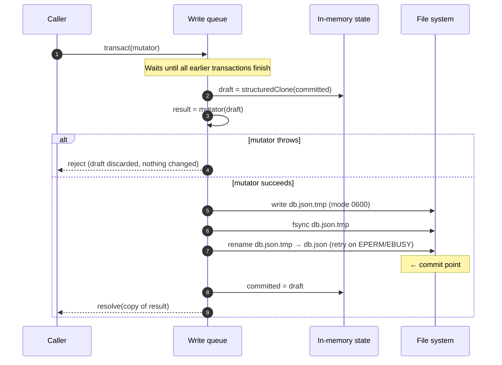
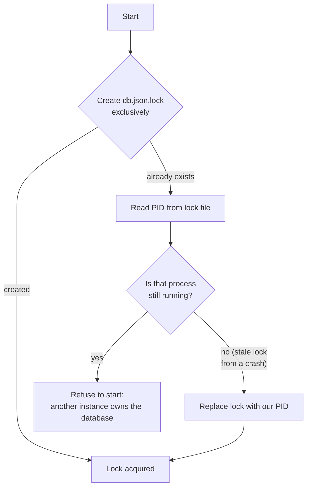

# 7. Persistence: the JSON file database

## 7.1 Why a hand-rolled store

The project requires a **file-based JSON database**. Using one naïvely (read the file, change it, write it back on each request) breaks quickly in a payment system:

| Problem | Example |
|---|---|
| **Lost updates** | Two refunds read the same payment, each adds its amount, and the second write overwrites the first |
| **Torn writes** | The process crashes halfway through writing, leaving `db.json` truncated and unreadable |
| **Partial changes** | Code updates a payment, then throws before writing its event, leaving a state change with no webhook |

`JsonDb` is a small layer (about 150 lines) that solves these by giving **transactions with ACID-like properties**.

| Alternative considered | Why it wasn't chosen |
|---|---|
| `lowdb` | Convenient, but writes aren't serialized against each other, and there's no all-or-nothing rollback. We would have had to build both on top anyway |
| SQLite | A real embedded database with true ACID transactions, but it isn't a *JSON file* database, which is a project requirement. `JsonDb` sits behind an interface, so SQLite is the natural upgrade path |
| One file per collection or per record | Atomic changes *across* records (payment + job + event + deliveries) would need a multi-file commit protocol. A single file makes "one rename = one commit" possible |

## 7.2 Interface

```ts
class JsonDb<S extends object> {
  /** Load the file (or create it with defaults), take the process lock, run migrations. */
  static open<S extends object>(options: { file: string; defaults: S }): Promise<JsonDb<S>>;

  /** Read from the last committed state. Returns a deep copy. */
  read<T>(selector: (data: Readonly<S>) => T): T;

  /** Run a mutation as a transaction. Serialized, all-or-nothing, durable on resolve. */
  transact<T>(mutator: (draft: S) => T): Promise<T>;

  /** Wait for all queued transactions, then release the lock. */
  close(): Promise<void>;
}
```

Usage:

```ts
const payment = await db.transact((d) => {
  const p = d.payments[id];
  if (!p || p.merchantId !== merchantId) throw new NotFoundError('payment', id);
  if (p.status !== 'authorized') throw new InvalidStateError(…);   // → whole transaction discarded
  p.status = 'capturing';
  d.jobs[job.id] = job;
  recordEvent(d, …);                                               // event + deliveries, same transaction
  return p;
});
```

| Decision | Why |
|---|---|
| **The mutator must be synchronous** (no `async`, enforced by the TypeScript type) | Transactions run one at a time. An `await` inside one (a processor call, an HTTP request) would block **every** other write while it waits. Keeping mutators synchronous forces slow work outside the transaction, which is exactly what the worker design does (see [Lifecycle §3.4](03-payment-lifecycle.md#34-the-payment-worker)) |
| **Throwing = rollback** | Business rules are checked inside the transaction and simply `throw`. There's no manual undo code to write or forget |
| **Reads return deep copies** | A caller can't accidentally modify committed data without going through `transact` |

## 7.3 How a transaction works



## 7.4 ACID properties

| Property | How `JsonDb` provides it | Caveat |
|---|---|---|
| **Atomicity** | Changes go to a *copy* of the data. If the mutator throws, the copy is thrown away. On disk, a **rename** replaces the whole file in a single step: readers see the old file or the new one, never a mix | – |
| **Consistency** | Business rules (state machine, amount limits, merchant ownership) are checked *inside* the transaction, against the latest committed state | Rules are enforced by our code, not by database constraints |
| **Isolation** | Transactions run **one at a time** through a promise queue, which gives *serializable* isolation, the strongest level. No transaction ever sees another's half-finished changes | Reads see the last *committed* state. A read during a pending write sees the state before that write |
| **Durability** | The temp file is `fsync`ed (flushed from OS buffers to disk) **before** the rename, and `transact()` resolves only after the rename. Once a caller gets a result, the data survives a process crash | On power loss, see §7.5 |

### Isolation

Serial execution sounds slow, but each transaction is a few in-memory operations plus one file write (about a millisecond for a small file). Slow work (processor calls, webhook HTTP requests) always happens *outside* transactions, so the queue never waits on the network.

## 7.5 Durability details and trade-offs

| Step | Purpose |
|---|---|
| Write to `db.json.tmp`, not `db.json` | The real file is never partly written |
| `fsync` the temp file | Without it, the OS may still hold the data in memory when we rename. A power cut could then leave an *empty* `db.json` |
| Rename over `db.json` | The single atomic commit step |

**Not done: `fsync` of the containing directory.** On some Linux filesystems, a rename isn't guaranteed to survive a sudden **power loss** until the directory itself is flushed.

**Why we skip it:** Node can't open a directory for `fsync` on Windows, so doing it would need platform-specific code. The worst case without it is that, after a power cut, the **last transaction may be missing**, but the file is always a **complete, valid** earlier version, never corrupted. That's acceptable for a simulator, and process crashes (far more common) are fully covered.

## 7.6 Cross-platform behaviour

The code has **no OS checks**. Each measure is written so it's harmless where it doesn't apply.

| Concern | Linux / macOS | Windows | How the code handles it |
|---|---|---|---|
| File permissions `0o600` / dir `0o700` | Enforced | Silently ignored (Windows uses ACLs) | Always passed. Windows hardening is a one-time deployment step (see [Security §4.11](04-security.md#411-file-permissions)) |
| Rename over an existing file | Atomic, always succeeds | Can fail with `EPERM`/`EBUSY` if another program briefly has the file open (antivirus, search indexer, an editor) | Retry the rename up to 5 times with short backoff, **based on the error code**. On Linux/macOS these errors don't happen, so the retry never runs |
| Process liveness check for the lock file (§7.7) | `process.kill(pid, 0)` | Same call works | Same code everywhere |

```ts
async function renameWithRetry(from: string, to: string, attempts = 5): Promise<void> {
  for (let i = 1; ; i++) {
    try {
      return await rename(from, to);
    } catch (err) {
      const code = (err as NodeJS.ErrnoException).code;
      if (i >= attempts || (code !== 'EPERM' && code !== 'EBUSY')) throw err;
      await new Promise((r) => setTimeout(r, 20 * i));
    }
  }
}
```

**Why retry on error codes rather than checking the platform:** it handles the *actual* failure wherever it happens, and stays a single code path that's tested the same way everywhere.

**Tip for Windows development:** exclude the `data/` folder from antivirus real-time scanning, and don't keep `db.json` open in an editor while the service runs. Both reduce rename retries.

## 7.7 Single-process lock

On startup, `JsonDb.open` creates `db.json.lock` **exclusively** (it fails if the file already exists) and writes the process ID into it.



The lock is deleted on graceful shutdown (`SIGINT` / `SIGTERM`), after all queued transactions finish.

**Why:** each process holds its own in-memory copy of the data. Two processes on the same file would each overwrite the other's commits: silent data loss, the worst kind. The lock turns that into a loud failure at startup.

## 7.8 Startup sequence

1. Take the lock (§7.7).
2. Delete a leftover `db.json.tmp` if there is one. It belongs to a commit that never reached its rename, so it's safe to discard.
3. Read `db.json`:
   - **missing** → create it with defaults;
   - **invalid JSON** → **refuse to start** and leave the file untouched;
   - **valid** → run any migrations from `meta.schemaVersion` up to the current version.
4. Start the HTTP server and the background loops.

**Why refuse instead of starting fresh on invalid JSON:** replacing an unreadable file with an empty database would **wipe every payment** on the next write. Stopping preserves the file so a human can inspect and repair it.

## 7.9 Performance

| Operation | Cost |
|---|---|
| Read by ID | Very cheap: in-memory lookup + copy of one record |
| List / filter | Scan of one collection in memory |
| Write | `structuredClone` of the whole dataset + serialize + write + fsync of the whole file |

Write cost grows with **total file size**, which is why:

- completed jobs, events and deliveries are **pruned** after `RETENTION_DAYS` (see [Data model §2.6](02-data-model.md#26-data-retention));
- `metadata`, descriptions and webhook endpoint counts are **capped**;
- API keys don't track `lastUsedAt` (it would make every request a write).

As a rough guide, a file of a few MB (thousands of payments) commits in a few milliseconds, which is fine for a simulator. Well beyond that, it's time to move to SQLite (§7.1).

## 7.10 Limitations

| Limitation | Consequence | Upgrade path |
|---|---|---|
| **Single process only** | No horizontal scaling. Workers must run in the same process | SQLite (still single-host), then Postgres |
| Whole-file rewrite on every write | Write latency grows with data size | Same as above |
| All data held in memory | RAM use is proportional to the database size | Same as above |
| No query language or secondary indexes | Filters are in-memory scans | Add in-memory indexes if a scan ever becomes noticeable |
| Last transaction may be lost on power failure (§7.5) | Never corruption, just possibly the most recent commit | Directory `fsync` on POSIX, or a real database |

All of these are acceptable for a simulator, and they're why `JsonDb` sits behind a narrow interface (`read` / `transact`): replacing it touches only the infrastructure layer (see [Architecture §1.2](01-architecture.md#12-layers)).
