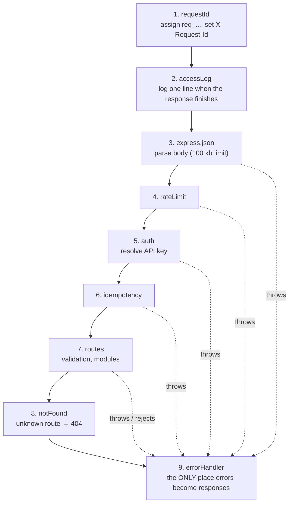
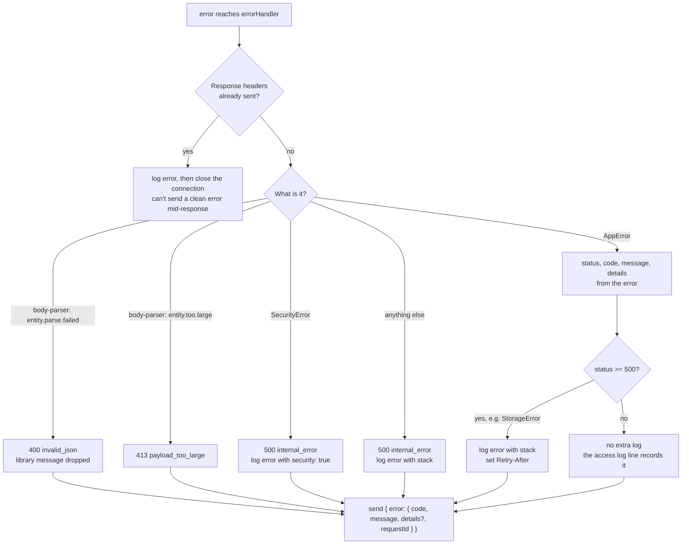
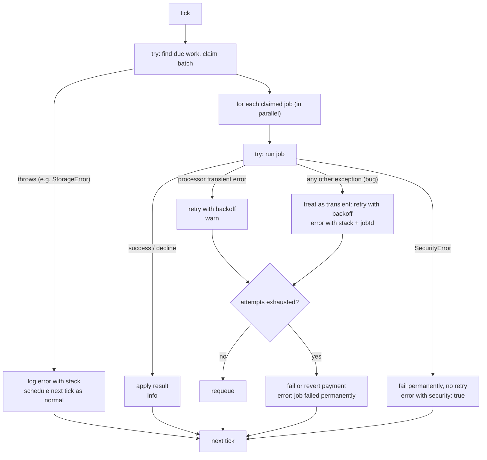
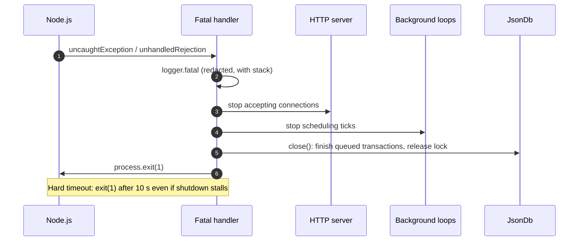

# 8. Error Handling and Logging

## 8.1 Goals

| Goal | What it means in practice |
|---|---|
| **Every error is caught** | No request hangs, no background loop dies silently, no exception goes unlogged |
| **Clients get useful, safe errors** | A stable `code`, a readable message, field-level details for bad input, and a `requestId`. Never stack traces, internal messages or echoed input |
| **The server log tells the full story** | Every 5xx has a stack trace and context (request, merchant, job), searchable by `requestId` |
| **Nothing sensitive is ever logged or returned** | No card numbers, CVCs, API keys, webhook secrets or decrypted values, even when they appear somewhere unexpected, such as inside an exception message |
| **No external services** | Logs go to the console (`console.log` / `console.warn` / `console.error`). No error-tracking service is used |

## 8.2 Error classification

Every error falls into exactly one class. The class decides what the client sees, how it's logged, and whether it's retried.

| Class | Examples | HTTP status | Client sees | Log level |
|---|---|---|---|---|
| **Client error** (`AppError`, status < 500) | Validation, invalid JSON, not found, invalid state, idempotency conflicts | 400, 404, 409, 413, 422 | Specific `code`, message, `details` | `info` |
| **Security-relevant client error** | Bad or revoked API key, wrong key type, rate limited | 401, 403, 429 | Specific `code`, message | `warn` |
| **Infrastructure failure** (`StorageError`) | DB commit failed: disk full, permission denied, I/O error | 503 + `Retry-After` | `service_unavailable`, generic message | `error` + stack |
| **Security event** (`SecurityError`) | Decryption failed (AAD or auth tag mismatch, unknown key version) | 500 | `internal_error`, generic message | `error` + stack, `security: true` |
| **Bug** (anything else) | `TypeError`, undefined property, a broken invariant | 500 | `internal_error`, generic message | `error` + stack |

| Decision | Why |
|---|---|
| **4xx logged at `info`, not `error`** | A 4xx means the *client* sent something wrong. That's normal traffic. Logging it as an error would bury the real problems |
| **401 / 403 / 429 at `warn`** | Unlike other 4xx errors, these can signal an attack: guessing keys, probing endpoints, testing stolen cards. `warn` makes a spike of them stand out |
| **Storage failures are 503, not 500** | The request was fine and nothing changed (the transaction was discarded, see [Persistence §7.4](07-persistence.md#74-acid-properties)), so retrying later is safe. 503 + `Retry-After` tells the client exactly that |
| **Security events have their own class** | A decryption failure isn't an ordinary bug: it can mean someone edited the database file. The `security: true` field lets these be searched for and alerted on separately |
| **The status code decides the log level** (< 500 → `info`/`warn`, ≥ 500 → `error`) | One simple rule that nobody can apply inconsistently |

### Error classes

```ts
abstract class AppError extends Error {
  abstract readonly status: number;
  abstract readonly code: string;
  readonly details?: Array<{ field: string; message: string }>;
  readonly retryAfterSeconds?: number;
}

class ValidationError        extends AppError { status = 400; code = 'validation_error' }
class InvalidJsonError       extends AppError { status = 400; code = 'invalid_json' }
class UnauthorizedError      extends AppError { status = 401; code = 'unauthorized' }
class ForbiddenError         extends AppError { status = 403; code = 'forbidden' }
class NotFoundError          extends AppError { status = 404; code = 'not_found' }
class InvalidStateError      extends AppError { status = 409; code = 'invalid_state' }
class ConflictError          extends AppError { status = 409; code = 'conflict' }
class IdempotencyInProgress  extends AppError { status = 409; code = 'idempotency_in_progress' }
class PayloadTooLargeError   extends AppError { status = 413; code = 'payload_too_large' }
class IdempotencyKeyReused   extends AppError { status = 422; code = 'idempotency_key_reused' }
class RateLimitedError       extends AppError { status = 429; code = 'rate_limited' }
class StorageError           extends AppError { status = 503; code = 'service_unavailable'; retryAfterSeconds = 30 }

class SecurityError extends Error {}   // deliberately NOT an AppError: its message must never reach the client
```

**Why a class per error instead of `throw { status, code }`:** classes carry a stack trace, can be checked with `instanceof`, and keep the list of possible codes in one file. A new error code is a one-line addition here, not a string scattered through the modules.

## 8.3 How an HTTP error flows

### Middleware order



| Decision | Why |
|---|---|
| **`requestId` runs first** | Every later log line, including errors from body parsing, can include the request ID |
| **The access log is written when the response finishes** | Exactly one line per request, with the final status and duration, whether it succeeded or failed |
| **One error handler, nothing else sends error responses** | Routes and modules only `throw`. All formatting, logging and redaction happens in one place, so no route can forget it or do it differently |
| **Express 5** | A rejected promise in an `async` handler goes to the error handler automatically. Express 4 would need a wrapper on every route, and a forgotten wrapper means a request that hangs forever |

### Error handler logic



**Why the original message of a body-parser error is dropped:** the JSON parser's message quotes part of the request body (`Unexpected token … in JSON at position …`). For a malformed `/tokens` request, that fragment could include a **card number**, which would then be echoed back to the client and written to the log.

## 8.4 What the client receives

Every error response has the same shape, and **always** includes the request ID:

```json
{
  "error": {
    "code": "validation_error",
    "message": "Invalid request",
    "details": [
      { "field": "card.number", "message": "must be a valid card number" },
      { "field": "amount", "message": "must be a positive integer in minor units" }
    ],
    "requestId": "req_1b7f0c9e2d4a4f3b8c6d5e7f9a0b1c2d"
  }
}
```

A server-side failure looks like this in **every environment**, development included:

```json
{
  "error": {
    "code": "internal_error",
    "message": "An unexpected error occurred. Quote the requestId if you contact support.",
    "requestId": "req_1b7f0c9e2d4a4f3b8c6d5e7f9a0b1c2d"
  }
}
```

| Rule | Why |
|---|---|
| 5xx bodies never contain stack traces, exception messages, file paths or internal names | They reveal how the system is built, which helps an attacker and means nothing to a client. The full detail is in the server log, one `requestId` away |
| Same 5xx body in development and production | An "only in dev" switch is easy to leave on by accident in production. Developers read the console log instead, which has everything |
| `details` contain **only the field path and our own message**, never the value received | The value may be the secret: an invalid card number, a malformed key. Validation messages are written by us (a custom zod error map), not taken from the library's defaults |
| Request input is never put into error messages, except resource IDs | `Payment pay_… not found` is useful and safe. `Invalid card 4242…` would leak |
| `Retry-After` header on 429 and 503 | Tells the client *when* retrying makes sense, so it doesn't retry in a tight loop |

The full list of status codes is in [Architecture §1.8](01-architecture.md#18-error-model).

## 8.5 Request IDs

- Every request gets an ID: `req_<32 hex>`.
- If a reverse proxy already sent `X-Request-Id` and it matches `^[A-Za-z0-9_-]{1,64}$`, **that ID is reused**. Otherwise a new one is generated.
- It's returned in the `X-Request-Id` response header (on every response, not only errors) and in every error body.
- It's included in **every** log line written while handling that request, and in the logs of the job a request creates.

**Why:** a client can report one ID ("I got a 500, `req_1b7f…`"), and a single search of the logs finds everything that happened for that request.
**Why validate an incoming ID:** a header value is written into logs. Restricting it to a safe character set and length stops anyone injecting fake log lines or huge values.

## 8.6 Server logging

### The logger

One small module, `src/logging/logger.ts`, is the **only** place that writes logs. No other code calls `console.*` directly.

```ts
logger.info('payment created', { requestId, merchantId, paymentId });
logger.warn('webhook delivery failed', { deliveryId, endpointId, status: 500, attempt: 3 });
logger.error('job handler crashed', { jobId, paymentId, err });
logger.fatal('uncaught exception', { err });
```

| Level | Console method | Stream | Used for |
|---|---|---|---|
| `debug` | `console.log` | stdout | Detailed tracing (off by default) |
| `info` | `console.log` | stdout | Access log lines, normal state changes, 4xx |
| `warn` | `console.warn` | stderr | 401/403/429, transient processor errors, webhook receiver failures, size warning |
| `error` | `console.error` | stderr | 5xx, job handler bugs, security events, storage failures |
| `fatal` | `console.error` | stderr | The process is about to exit |

`LOG_LEVEL` (default `info`) sets the minimum level written.

Each entry is **one line of JSON**:

```json
{"time":"2026-10-17T09:30:00.123Z","level":"error","msg":"request failed","requestId":"req_1b7f…","method":"POST","route":"/payments/:id/refund","status":500,"durationMs":12,"merchantId":"mer_7c1e…","keyId":"key_a81b…","err":{"name":"TypeError","message":"Cannot read properties of undefined (reading 'amountCaptured')","stack":"TypeError: Cannot read …\n    at refund (src/modules/payments/service.ts:142:31)\n    …"}}
```

| Decision | Why |
|---|---|
| **Console only, no logging library** | Project requirement. The console is enough for a single process, and it works with any log collector (systemd journal, Docker, a cloud agent), since they all read stdout and stderr |
| **One wrapper module instead of calling `console.*` everywhere** | Redaction (§8.7), levels and formatting are applied in one place, so no code path can skip them. If an error-tracking service is ever wanted, it's a single addition inside `logger.error` |
| **One JSON line per entry** | One entry stays on one line, so it can't be broken up or interleaved. It's searchable with `grep` or `jq` (`jq 'select(.requestId=="req_…")'`) and parsed directly by log tools |
| **`warn`/`error` go to stderr, the rest to stdout** | Lets an operator watch only the problems (`2>` redirect) without filtering |
| **Log the route pattern (`/payments/:id/refund`), not the raw URL** | Groups related requests together, and query strings, which may contain merchant data such as `customerId`, stay out of the logs |

### What each request logs

Exactly **one access line** when the response finishes: `requestId`, method, route, status, `durationMs`, `merchantId`, `keyId`, and the error `code` if there was one. A 5xx adds the serialized `err` (name, message, stack, `cause` chain up to 3 levels).

Never logged: request or response **bodies**, headers (the request ID aside), or any decrypted value. See [Security §4.10](04-security.md#410-logging-and-redaction).

## 8.7 Redaction: the safety net

The main rule is **don't log sensitive data in the first place**: log only known-safe fields. Redaction exists for the cases where that rule fails, for example a library that puts a request value into an exception message. Every value passed to the logger goes through `redact()` first. It uses two independent layers:

**Layer 1: by key name.** Any object property with one of these names (case-insensitive) is replaced with `"[REDACTED]"`, at any depth:

`authorization` · `cookie` · `card` · `cvc` · `secret` · `secretHash` · `secretEncrypted` · `numberEncrypted` · `apiKeys` · `key`

**Layer 2: by value pattern.** Every string, **including error messages and stack traces**, is scanned:

| Pattern | Replaced with |
|---|---|
| `(sk\|pk)_test_<16 hex>_<43 chars>` | `sk_test_[REDACTED]` / `pk_test_[REDACTED]` |
| `whsec_<43 chars>` | `whsec_[REDACTED]` |
| `Bearer <anything>` | `Bearer [REDACTED]` |
| 12–19 digits (spaces or dashes allowed) **that pass the Luhn check** | `[REDACTED_PAN]` |
| `v<n>:<base64>:<base64>:<base64>` (our ciphertext format) | `[REDACTED_CIPHERTEXT]` |

Also: strings longer than 2,000 characters are truncated, nesting is cut off at depth 6, and circular references are replaced with `"[Circular]"`, so logging can never itself crash or flood the console.

| Decision | Why |
|---|---|
| **Two layers** | Key names reliably catch the fields we know about. Value patterns catch secrets in places we didn't predict, like a card number quoted inside a third-party error message |
| **Scan error messages and stacks too** | That's where unexpected leaks usually come from: an exception message built from input data |
| **Luhn check on digit sequences** | Masking *every* long number would also hide timestamps and amounts that are useful in logs. The Luhn check removes most false positives, and masking an occasional harmless number is cheap compared with logging a real card number |
| **Redact before writing, not afterwards** | Once a secret is in a log file, it's copied to backups and log collectors and can't be reliably removed |

## 8.8 Background process errors

The payment worker, webhook dispatcher and housekeeping loop have no HTTP request to fail. Their errors are handled **at two levels**:



| Failure | Handling | Level |
|---|---|---|
| Processor decline | Normal outcome. Payment → `failed` | `info` |
| Processor transient error | Retry with backoff | `warn` |
| **Bug inside a job handler** | Caught **per job**, retried like a transient error, then the payment is failed or reverted | `error` + stack + `jobId`, `paymentId`, `merchantId`, `attempt` |
| **Decryption failure** for a card | Fail permanently (retrying can't help). The payment fails with the generic `processing_error`, so the merchant learns nothing about the cause | `error`, `security: true`, with the record ID (never the ciphertext) |
| **Exception in the tick itself** (e.g. storage failure while claiming) | Caught at tick level. The loop **carries on** at the next tick | `error` + stack |
| Merchant's receiver returns non-2xx, times out or refuses the connection | Retry on the webhook schedule. Recorded in the delivery log | `warn`, with `deliveryId`, `endpointId`, `status`. The response body is **not** logged |
| Webhook URL blocked by the SSRF check at delivery time | Counted as a failed attempt | `warn` |
| Our own failure while sending a webhook (e.g. decrypting the secret) | Same as a job bug, or as a security event for decryption | `error` |

| Decision | Why |
|---|---|
| **Catch per job *and* per tick** | Per job: one broken payment can't stall everyone else's. Per tick: a temporary storage problem can't permanently stop the loop |
| **A bug in a job is retried, not failed immediately** | Some "bugs" are really temporary conditions, such as a race with a concurrent update. Retrying costs little, and the backoff stops a real bug from looping fast |
| **A receiver failure is `warn`, not `error`** | A merchant's server being down is their problem and an expected situation the retry schedule exists for. Logging it as an error would bury our own failures |

## 8.9 Process-level failures



| Event | Handling | Exit code |
|---|---|---|
| `uncaughtException`, `unhandledRejection` | `fatal` log → graceful shutdown → exit | 1 |
| `SIGTERM`, `SIGINT` | `info` log → same graceful shutdown | 0 |
| Startup failure (invalid config, unreadable DB file, lock held by another process) | `fatal` log naming the cause → exit. Config errors name the **variable**, never its value | 1 |

| Decision | Why |
|---|---|
| **Exit after an uncaught exception instead of carrying on** | Something failed in a way no code anticipated, so the in-memory state may be inconsistent. Carrying on risks writing that bad state to the database |
| **Restarting is safe** | Jobs and deliveries are stored in the database, their leases expire, and a stale lock from the dead process is taken over (see [Persistence §7.7](07-persistence.md#77-single-process-lock)). Nothing is lost by crashing |
| **Hard 10 s timeout** | A shutdown that hangs (e.g. on a stuck file write) must not leave a half-dead process running |
| **Config errors don't print values** | `ENCRYPTION_KEYS` is invalid is enough to fix it. Printing the value would put a master key in the log |

⚠️ **The service must run under a process supervisor** (systemd, pm2, or a container restart policy) that restarts it when it exits with code 1. This is a deployment requirement, documented in the README.

## 8.10 Storage failures

`JsonDb` wraps any failure during a commit (write, `fsync` or rename: `ENOSPC`, `EACCES`, `EIO`, `EROFS`, …) in a `StorageError`, with the original error as its `cause`.

- **Data stays consistent.** The transaction's draft is discarded and the in-memory state is unchanged, so memory and file still agree.
- **HTTP** → `503 service_unavailable`, `Retry-After: 30`, logged as `error` with the cause.
- **Workers** → the tick-level catch logs it, and the next tick tries again.
- The process **doesn't** exit. Once the disk problem is fixed (space freed, permissions corrected), the service recovers by itself.

**Why not crash on a storage failure:** unlike an uncaught exception, this failure is fully understood and the state is consistent. Crashing wouldn't fix a full disk; it would just add restarts to an existing outage.

## 8.11 Errors and idempotency

| First response to an `Idempotency-Key` | Stored and replayed? | Why |
|---|---|---|
| 2xx | Yes | The operation happened. A retry must not repeat it |
| 4xx from validation or a business rule | Yes | The same request will always get the same answer. Replaying it is consistent and cheap |
| **5xx** (bug, storage failure, security event) | **No**: the key's reservation is released | The failure was ours and may be temporary. If it were stored, a client retrying with the same key would get the same 500 forever, even after the problem is fixed |

Requests rejected *before* the idempotency step (401, 403, 429, invalid JSON) never reserve a key.

## 8.12 Testing the error paths

### Error handler and client contract

| Test | Checks | Edge case guarded |
|---|---|---|
| Each `AppError` class → its documented status, `code`, `details` and `Retry-After` (429/503) | Classification (§8.2) | Codes drifting from the docs |
| Route throws a `TypeError` with a message containing a card number → generic `500 internal_error`. The body has no message, stack or number | Bugs revealed to nobody (§8.4) | Internal details or secrets in error responses |
| `SecurityError` → generic `500`. The log entry has `security: true` and no ciphertext | Security events | Telling an attacker that tampering was detected |
| Malformed JSON containing a card number → `400 invalid_json`. Neither the response nor the log contains the number | Library messages dropped | The JSON parser quoting the body back |
| Validation error for an invalid card number → `details` names `card.number` but doesn't include the value | Values never echoed | Secrets in validation messages |
| Error thrown **after** the response headers were sent → logged, connection closed, the process keeps running | `headersSent` branch | A crash, or a garbled second response |
| Async route handler that rejects → reaches the error handler (no hanging request) | Express 5 async forwarding | Requests that never get a response |

### Request IDs

| Test | Checks | Edge case guarded |
|---|---|---|
| Valid incoming `X-Request-Id` → reused in the response header, error body and logs | Proxy correlation (§8.5) | – |
| Incoming ID with invalid characters, newlines, or over 64 chars → replaced by a generated one | Validation | Log injection through a header |
| A job created by a request logs the same `requestId` | Correlation across async work | Not being able to trace a payment from request to worker |

### Logger and redaction (unit)

| Test | Checks | Edge case guarded |
|---|---|---|
| Each level goes to its documented console method. `LOG_LEVEL=warn` suppresses `info` and `debug` | Levels (§8.6) | Errors going to stdout, or noise ignoring the level |
| Every entry is a single line of valid JSON, even when a message contains newlines | Line format | Entries split across lines and broken apart |
| Each layer-1 key (`authorization`, `card`, `cvc`, `secret`, …) is redacted at any depth, case-insensitively | Key redaction (§8.7) | Known sensitive fields logged |
| Each layer-2 pattern (`sk_`/`pk_` keys, `whsec_`, `Bearer`, Luhn-valid card numbers, ciphertext) is masked inside plain strings, error messages **and** stack traces | Pattern redaction | Secrets hidden inside free text |
| A 13-digit timestamp and an amount like `100000` are **not** masked | The Luhn check limits false positives | Useful log data destroyed |
| Circular object, depth 10, 1 MB string → logged as `[Circular]`, cut off at depth 6, truncated at 2,000 chars, without throwing | Logging is robust | Logging itself crashing or flooding the console |
| 401, 403 and 429 responses are logged at `warn`. Other 4xx at `info`. 5xx at `error` | Level by status | Attack signals buried, or 4xx noise counted as errors |

### Background and process failures

| Test | Checks | Edge case guarded |
|---|---|---|
| Job handler throws → retried with backoff, then the payment fails or reverts. Other jobs in the same tick complete | Per-job catch (§8.8) | One bad job stalling the queue |
| The claim step throws in a tick → `error` logged, and the next `tickOnce()` works normally | Per-tick catch | A loop that dies after one exception |
| Decryption failure in the worker → no retry, payment `failed` with `processing_error`, `security: true` log | Security events in jobs | Retrying tampered data, or revealing the cause |
| Receiver returns 500 → `warn`, not `error` | Merchant-side failures | Our error log filling with merchants' problems |
| Spawned server with a route that triggers an unhandled rejection → `fatal` log, lock removed, exit code 1 | Fatal handling (§8.9) | Running on in a broken state, or dying without a trace |
| Spawned server whose shutdown is made to hang → killed after 10 s with exit code 1 | Hard timeout | A half-dead process that never exits |

### Storage and idempotency

| Test | Checks | Edge case guarded |
|---|---|---|
| Storage failure during a request → `503` + `Retry-After: 30`, state unchanged. Recovers once writable, without a restart | Storage failures (§8.10) | Crash loops over a full disk |
| A 5xx response to a request with an `Idempotency-Key` → the retry with the same key runs again | §8.11 | Replaying a temporary failure forever |

### Suite-wide

| Test | Checks | Edge case guarded |
|---|---|---|
| **Log leak test**: all console output from the whole suite is captured, and no line may contain a test card number, a test CVC, or any `sk_`, `pk_` or `whsec_` value issued during the run | Nothing sensitive ever logged ([Testing §9.5](09-testing.md#95-tests-that-span-the-whole-suite)) | A new log line or error field leaking data |

**Why a dedicated leak test:** redaction is easy to break without noticing. A new log line, or a new field in an error, can leak without any functional test failing. Scanning every line produced by the full suite catches this automatically.
