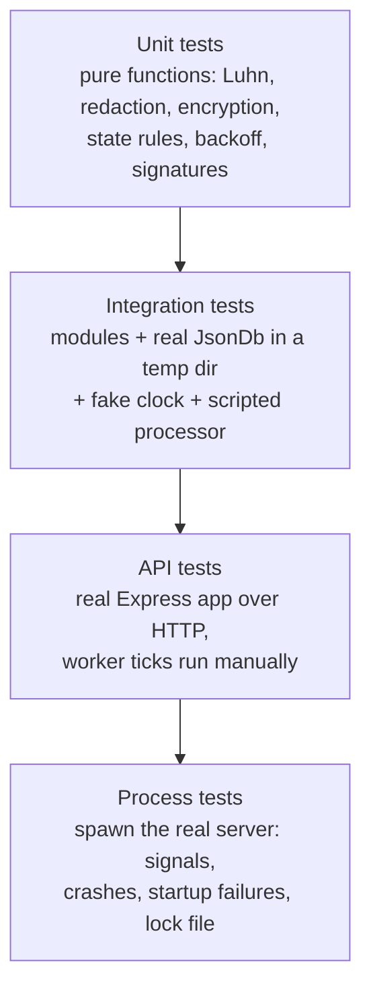

# 9. Testing Strategy

This document describes **how** the service is tested. **What** is tested lives next to the design it checks: every document ends with a **Tests** section listing each test, what it checks, and the edge case it guards against.

| Module / area | Tests section |
|---|---|
| Config, app wiring, request IDs, background loop lifecycle | [Architecture §1.9](01-architecture.md#19-tests) |
| Views, IDs, input limits, retention, schema versions | [Data model §2.7](02-data-model.md#27-tests) |
| `payments` module, payment worker, simulated processor | [Payment lifecycle §3.6](03-payment-lifecycle.md#36-tests) |
| `crypto`, `apiKeys`, merchant isolation, SSRF, rate limits | [Security §4.13](04-security.md#413-tests) |
| HTTP contract: auth matrix, status codes, pagination, idempotency, `merchants`, `tokens`, `cards` | [API reference §5.11](05-api.md#511-tests) |
| `webhooks` and `events` modules, webhook dispatcher | [Webhooks §6.8](06-webhooks.md#68-tests) |
| `JsonDb` | [Persistence §7.12](07-persistence.md#712-tests) |
| Errors, logger, redaction, process failures | [Error handling §8.12](08-error-handling.md#812-testing-the-error-paths) |
| Everything together, against the real running server | [Smoke tests §9.8](#98-smoke-tests) |

**Why keep test lists next to the design instead of in one big test plan:** when someone changes a design decision, the tests that prove it are on the same page. That makes it obvious which tests need updating, and lets a reviewer check each "why" against a test that enforces it.

## 9.1 Tools

| Tool | Why |
|---|---|
| **`node:test`** + **`node:assert/strict`** | Built into Node: no test framework to install or configure. Supports subtests, `describe`/`it`, mocking and parallel runs |
| **`tsx`** (`node --test --import tsx`) | Runs TypeScript test files directly, with no separate build step before testing |
| **Built-in `fetch`** against the app on a random port | Tests the real HTTP stack (Express, middleware, error handler) with no extra dependency like `supertest` |
| **`node --test --experimental-test-coverage`** | Built-in coverage report, so there's no extra tool |

## 9.2 Test levels



| Level | Where | What it's for | Speed |
|---|---|---|---|
| **Unit** | `test/unit/` | Logic that has no I/O. Checked exhaustively with tables of inputs | Milliseconds |
| **Integration** | `test/integration/` | Modules working with a real `JsonDb` on a temp file: transactions, rollbacks, invariants | Fast |
| **API** | `test/api/` | The documented HTTP contract: status codes, bodies, headers, auth | Fast |
| **Process** | `test/process/` | Things only a real process shows: exit codes, signal handling, stale locks, startup refusal | Slower (spawns Node) |

**Why a real `JsonDb` instead of mocking the database:** the database *is* the hard part. Transactions, rollback, serialization and file writes are where bugs hide. A mock would test our assumptions about the database, not the database itself. Temp files are fast enough that mocking gains nothing.

## 9.3 Determinism

A test that sometimes fails is worse than no test, because people learn to ignore it. Everything that could make a test non-deterministic is **injected** (the dependency-injection design from [Architecture §1.2](01-architecture.md#12-layers)):

| Source of non-determinism | Replaced in tests by | Lets us test |
|---|---|---|
| Time (`Date.now()`) | **Fake clock** with `advance(ms)` | Token expiry, backoff schedules, lease expiry, retention, idempotency expiry, card expiry at a month boundary, without sleeping |
| Background timers | **`tickOnce()`** on each loop, called directly by the test | Exactly one worker or dispatcher pass, at the moment the test chooses |
| The processor (latency, random failures) | **Scripted processor**: a queue of outcomes (`success`, `declined`, `error`), plus a "blocking" mode that holds calls open | Every outcome on demand, retry paths, how many calls run at once |
| DNS resolution | **Fake resolver** mapping hostnames to IPs | SSRF checks, including DNS rebinding, with no network access |
| Webhook receivers | **Local HTTP server** on `127.0.0.1` with scripted responses (with `WEBHOOK_ALLOW_INSECURE_URLS=true`) | Real signed deliveries, status codes, timeouts, huge responses |
| File system calls in `JsonDb` (`rename`, `fsync`) | **Injectable file operations** | `EPERM`/`EBUSY` retries, disk failures, and the order of operations, on any OS |

**Why `tickOnce()` instead of waiting for the real loop:** waiting means sleeps, and sleeps make tests slow and flaky. Calling one tick directly makes "what has happened so far" exact.

## 9.4 Isolation

- **Every test file gets its own temp directory and database file**, deleted afterwards. Tests can run in parallel and never share state.
- Each API test file starts its own app on **port 0** (the OS picks a free port), so two runs never clash.
- Helpers create fresh merchants per test (`createMerchant()` returns `{ merchant, pk, sk }`), so no test depends on data another test left behind.

**Why no shared fixtures:** shared data makes tests depend on run order, and the first change to that data breaks unrelated tests.

## 9.5 Tests that span the whole suite

Two checks run over the output of the **entire suite**, not one feature:

| Check | How | Guards against |
|---|---|---|
| **No secrets in logs** | All console output is captured during the suite. Afterwards, no line may contain a test card number, a CVC used in tests, or any `sk_`, `pk_`, `whsec_` value issued during the run | A new log line or error field leaking sensitive data ([Error handling §8.7](08-error-handling.md#87-redaction-the-safety-net)) |
| **No secrets in the database file** | After each API test file, its `db.json` is scanned the same way. Card numbers may appear only inside ciphertext, and secret keys and CVCs never | A code change that accidentally stores a plain value ([Security §4.4](04-security.md#44-encryption-at-rest-aes-256-gcm)) |

**Why suite-wide:** a leak can come from any feature, including ones written later. Checking everything automatically doesn't depend on someone remembering to add a leak test for each new feature.

## 9.6 Conventions

- **Test names cite the doc section they verify**, e.g. `"§3.2 refund while refunding → 409 invalid_state"`. A failing test points straight at the rule it protects.
- **Table-driven tests** for rule matrices (status × action, auth key × endpoint, URL × SSRF verdict). Every combination is listed explicitly, so a missing one is visible.
- **Invariant checks after concurrency tests**: e.g. `amountRefundedMinor ≤ amountCapturedMinor` and "exactly one active key per type", checked after firing many requests at once.
- **Each bug fix comes with a test** that fails without the fix.

## 9.7 Running tests

| Command | Runs |
|---|---|
| `yarn test` | Everything |
| `yarn test:unit` / `test:integration` / `test:api` / `test:process` | One level |
| `yarn test:coverage` | Everything, with a coverage report |
| `yarn smoke` | Smoke tests against the real running server (§9.8). Separate from `yarn test` because it starts a real process and takes about 2 minutes |
| `yarn bench:db` | The `JsonDb` benchmark ([Persistence §7.9](07-persistence.md#79-performance-and-capacity)). A measurement, not a test, so it isn't part of `yarn test` |

**Coverage target:** ≥ 90% of lines in `src/modules`, `src/db`, `src/crypto` and `src/logging`, which hold the logic and security-critical code. Coverage is reported, not used as a gate.

**Why not gate on coverage:** a hard threshold encourages tests that run code without checking anything. The doc-linked test lists are the real definition of "tested enough". Coverage only highlights code that no listed test reaches.

## 9.8 Smoke tests

### What they are for

The automated tests in §9.1–9.7 are precise, but they run the app *in-process*, with a fake clock, a scripted processor and the background loops driven by hand. Smoke tests answer a different question: **does the real thing work when it's actually running?**

`yarn smoke` starts the **real server** (`src/server.ts`) as its own process. It gets a random port, freshly generated secrets, a temp database, the real payment worker, webhook dispatcher and housekeeping loops, and a simulated processor with real latency (50 ms). Then it calls the **real endpoints over HTTP**, the way a merchant's server, a browser or a webhook receiver would.

| What smoke tests help us do | How |
|---|---|
| **Quickly run many scenarios end to end** | About 190 checks across every module run in roughly two minutes with one command, with no manual curl work |
| **See features working together** | A payment goes through tokenization, async processing, capture, refund and signed webhook delivery, exactly as a client would experience it |
| **Try to break it** | Every scenario sends hostile input, fires concurrent requests and probes across merchants, then checks that the server is still healthy |
| **Check what only a running process shows** | Real timers and retries, real network calls to a webhook receiver, the real log output, clean shutdown on `SIGTERM` |
| **Catch leaks** | After every run, all server logs and the database file are scanned for card numbers, CVCs, secret keys and webhook secrets |

**Why have both:** the automated tests prove each rule precisely and deterministically. Smoke tests prove the assembled service behaves correctly under realistic conditions. A bug in wiring, configuration, timing or logging can pass every unit test and still show up here.

Each check prints `✓` or `✗`. A failed check prints the response that caused it. The command exits with code 1 if any check fails.

### What each scenario covers

Scenarios run in this order. Later ones reuse the merchant created by `merchants`, and `ratelimits` runs last because it deliberately uses up the limits.

#### `foundation`: the HTTP skeleton

| Happy paths | Edge cases and attacks |
|---|---|
| `GET /health` returns `200 {status: ok}` | Malformed JSON → `400 invalid_json`, and the card number in it is **not** echoed back |
| Every response has an `X-Request-Id` | 200 kb body → `413 payload_too_large` |
| `GET /openapi.json` serves the OpenAPI 3.1 document | 5,000-level nested JSON and an unsupported charset → clean `4xx`, no crash |
| `GET /docs/` serves Swagger UI | Garbage bytes on a raw socket and a 20 kb header → `400`/`431` or connection closed, no crash |
| Unknown route or wrong method → JSON `404` (never HTML) | A valid incoming `X-Request-Id` is reused; a malicious one (spaces, injected JSON) is replaced |
| Every log line is valid single-line JSON with `requestId` and route | Path traversal (`/..%2f..%2fetc%2fpasswd`) → `404`; 200 concurrent requests → all `200`; server still healthy afterwards |

#### `merchants`: sign-up, authentication, key rotation

| Happy paths | Edge cases and attacks |
|---|---|
| `POST /merchants` → `201` with merchant and key pair; email stored lowercased | SQL-injection, `<script>` and emoji names are stored and returned **verbatim** (no interpretation) |
| `GET /merchants/me` works with the new secret key | Whitespace-only or 10,000-char name, header-injection email, wrong types, `__proto__` / `constructor` pollution, typo'd fields → all `400` |
| `GET /api-keys` shows the full `pk` and only the last 4 characters of the `sk` | Duplicate email in different case → `409`; 8 simultaneous sign-ups with one email → exactly one `201` |
| Rotating the secret key → the new key works, the old key gets `401` immediately | 8 bad-key variants (missing, `Basic`, one char changed, made-up, `pk` relabelled as `sk`, 8 kb garbage, two keys) → all `401` with **identical** bodies |
| Rotating the publishable key leaves the secret key working | Lowercase `bearer` accepted; `pk` on a secret route → `403`; rotating with a `pk` → `403`; invalid rotation type → `400` |
| Key list shows exactly one active key per type, and keeps revoked ones | 10 concurrent rotations → exactly **one** usable key remains; 401s are logged at `warn` |

#### `cards`: tokens and saved cards

| Happy paths | Edge cases and attacks |
|---|---|
| `POST /tokens` with the publishable key → `201 tok_…` with brand/last 4, never the number or CVC | Luhn failure, full-width Unicode digits, a 90 kb number, number as an integer, expired card, month 13, fractional month, negative year, bad CVC, extra `cvv` field, card as null/string/array → all `400`, number never echoed |
| `POST /cards` from a token → `201 card_…` | 10 parallel saves with one token → exactly one `201`, nine `400` (single use) |
| `GET /cards/:id` and `GET /cards?customerId=` return the saved card | Another merchant's token → same `400` as an unknown token; another merchant can't GET, DELETE or list my card (`404`) |
| Same card saved twice for one customer → `200` with the **same** card | Publishable key can't save cards (`403`); no key → `401` |
| `DELETE` → `204`, then `404` | 6 parallel requests with one `Idempotency-Key` → one real creation; a retry is replayed; the same key with a different body → `422`; exactly one card exists afterwards |

#### `payments`: asynchronous processing

| Happy paths | Edge cases and attacks |
|---|---|
| Token payment → `202 pending` → automatically `captured`; history = created, authorized, captured | Cancel or refund while `pending` → `409`; refund before capture → `409`; capture more than authorized → `400` |
| Worker log carries the same `requestId` as the request that created the payment | Capture and cancel fired at the same time → exactly one accepted |
| Manual capture: `authorized` → partial capture 2000/2500 → refund 500 → refund the rest → `refunded` (capped at the **captured** amount) | 10 simultaneous full refunds → exactly one accepted, never over-refunded; refunding a fully refunded payment → `409`; capturing a failed payment → `409` |
| Cancel an authorized payment → `cancelled` | PATCH `status: "authorized"` → `400`; PATCH `amountMinor` without status → `400`; PATCH `status: "refunded"` on an authorized payment → `409`; negative, fractional, string, oversized or null amounts; unknown currency; no card source; two sources; a used token; `saveCard` with `cardId`; 21 metadata keys; nested metadata; typo'd fields → all `400` |
| Test cards: declined, insufficient funds, expired, incorrect CVC → `failed` with the right code | Unknown `cardId` → `404`; `pk` can't create payments → `403` |
| PATCH merges metadata (`null` deletes a key). PATCH `status` (project requirement): `captured` + `amountMinor` + description → `202` and `captured`; then `refunded` → `refunded` | Same `Idempotency-Key` → the same payment is replayed; same key with a different amount → `422`; only one payment exists |
| `saveCard` + approval → card saved and listed | Another merchant can't get, patch or refund my payment (`404`), and my payment is untouched |
| | `saveCard` + decline → card **not** saved; deleting a card a pending payment needs → `409` |
| | The `processing_error` card is retried (logged at `warn`) and finally fails (logged at `error`) after ~30 s |

#### `webhooks`: signed delivery and SSRF protection

| Happy paths | Edge cases and attacks |
|---|---|
| `POST /webhooks` → `201` with a `whsec_` secret shown once; `GET` never shows it | Receiver returns `500` → delivery stays pending, `lastError` "HTTP 500", next retry ~1 minute later, logged at `warn` |
| A real local receiver gets `payment.created`, `payment.authorized` and `payment.captured` | Receiver that never answers → `"timeout"` after ~10 s |
| Every delivery verifies with an **independently written** HMAC check; `Webhook-Id`/`Webhook-Event` headers match the event | A tampered body fails verification; deleting an endpoint removes its delivery log |
| `data.object` is the payment as it was at that moment | Unknown event type, `"*"` mixed with types, empty list, `javascript:`/`file:` URLs, credentials in the URL, a 3 kb URL → all `400` |
| `GET /events?type=payment.captured` includes the payment | Registering the same URL again, even with different case or a `#fragment` → `409`; 6th endpoint → `409`; another merchant can't read, change or rotate my endpoint, or see my events |
| `rotate-secret` → new deliveries verify with the new secret and **fail** with the old one | **A second server in secure mode** rejects private targets using real DNS: `http://`, `localhost`, `127.0.0.1`, `10.x`, `192.168.x`, cloud metadata `169.254.169.254`, `[::1]`, `[::ffff:127.0.0.1]`, `2130706433`, `0x7f.1`, `0.0.0.0` |

#### `ratelimits`: limits under flood (runs last)

| Happy paths | Edge cases and attacks |
|---|---|
| Existing merchants keep working after the sign-up limit is hit | Sign-up flood → `429 rate_limited` with a sensible `Retry-After`, logged at `warn` |
| | Flooding one secret key → `429` once its per-key budget runs out |
| | Flooding `POST /tokens` with one publishable key → `429` (card-testing protection) |

#### Always: shutdown and leak scan

After the scenarios, every run checks:
- no card number, CVC, secret key or webhook secret appears in the **server logs** or the **database file**;
- the server exits with code `0` on `SIGTERM`.

### How to run them

```bash
yarn install
yarn gen:secrets                            # creates .env with placeholder secrets
yarn test                                   # all automated tests
yarn smoke                                  # real server, every scenario (about 2 min)
PROCESSOR_FAILURE_RATE=0.3 yarn smoke       # chaos mode
yarn bench:db                               # capacity measurements
yarn dev                                    # then open http://localhost:3000/docs
```

The smoke tests generate their own secrets, port and temp database, so they don't need `.env` and never touch `data/db.json`.

| Variation | Command |
|---|---|
| One or more scenarios | `yarn smoke payments` or `yarn smoke cards webhooks`. Prerequisites (`merchants`, plus `cards` for `payments`) are added automatically |
| Chaos mode | `PROCESSOR_FAILURE_RATE=0.3 yarn smoke`: 30% of processor calls fail at random. The server must never crash or leak; a few final-state checks may legitimately miss if a payment runs out of retries |

**Rate limits during smoke runs:** the smoke server raises the limits (40 sign-ups/hour, 120 tokens/minute, 600 requests/minute) so scenarios have room to work. `ratelimits` then exhausts them on purpose.

## 9.9 What isn't tested, and why

| Not tested | Why | What covers the risk instead |
|---|---|---|
| A real card network or gateway | Doesn't exist. This is a simulator | The `Processor` interface is tested through the scripted processor |
| Power loss during a commit | Can't be reliably simulated in a test | The design guarantees a valid earlier file ([Persistence §7.5](07-persistence.md#75-durability-details-and-trade-offs)). Crash mid-commit *is* tested via a leftover temp file |
| Real Windows antivirus file locks | Not reproducible on demand | `EPERM`/`EBUSY` are injected through the file operations seam |
| Real internet DNS and webhook targets | Tests must not depend on the network | Fake resolver + local receiver |
| Timing attacks on key comparison | Timing can't be measured reliably in unit tests | Code review checks that `timingSafeEqual` is used. Tests check its length-mismatch handling |
| Load and throughput | Depends on the machine. Not a pass/fail property | `yarn bench:db` measures it |
