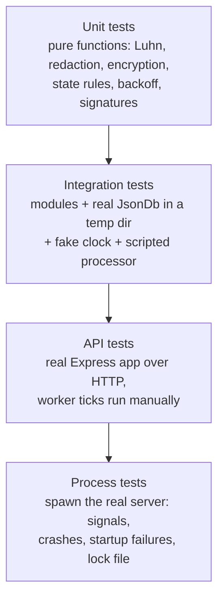

# 9. Testing Strategy

This document describes **how** the service is tested. **What** is tested lives next to the design it checks: every document ends with a **Tests** section listing each test, what it checks, and the edge case it guards against.

| Module / area | Tests section |
|---|---|
| Config, app wiring, request IDs, background loop lifecycle | [Architecture §1.9](01-architecture.md#19-tests) |
| Views, IDs, input limits, retention, schema versions | [Data model §2.7](02-data-model.md#27-tests) |
| `payments` module, payment worker, simulated processor | [Payment lifecycle §3.6](03-payment-lifecycle.md#36-tests) |
| `crypto`, `apiKeys`, merchant isolation, SSRF, rate limits | [Security §4.13](04-security.md#413-tests) |
| HTTP contract: auth matrix, status codes, pagination, idempotency, `merchants`, `tokens`, `cards` | [API reference §5.11](05-api.md#511-tests) |
| `webhooks` and `events` modules, webhook dispatcher | [Webhooks §6.8](06-webhooks.md#68-tests) |
| `JsonDb` | [Persistence §7.12](07-persistence.md#712-tests) |
| Errors, logger, redaction, process failures | [Error handling §8.12](08-error-handling.md#812-testing-the-error-paths) |

**Why keep test lists next to the design instead of in one big test plan:** when someone changes a design decision, the tests that prove it are on the same page. That makes it obvious which tests need updating, and lets a reviewer check each "why" against a test that enforces it.

## 9.1 Tools

| Tool | Why |
|---|---|
| **`node:test`** + **`node:assert/strict`** | Built into Node: no test framework to install or configure. Supports subtests, `describe`/`it`, mocking and parallel runs |
| **`tsx`** (`node --test --import tsx`) | Runs TypeScript test files directly, with no separate build step before testing |
| **Built-in `fetch`** against the app on a random port | Tests the real HTTP stack (Express, middleware, error handler) with no extra dependency like `supertest` |
| **`node --test --experimental-test-coverage`** | Built-in coverage report, so there's no extra tool |

## 9.2 Test levels

| Level | Where | What it's for | Speed |
|---|---|---|---|
| **Unit** | `test/unit/` | Logic that has no I/O. Checked exhaustively with tables of inputs | Milliseconds |
| **Integration** | `test/integration/` | Modules working with a real `JsonDb` on a temp file: transactions, rollbacks, invariants | Fast |
| **API** | `test/api/` | The documented HTTP contract: status codes, bodies, headers, auth | Fast |
| **Process** | `test/process/` | Things only a real process shows: exit codes, signal handling, stale locks, startup refusal | Slower (spawns Node) |

**Why a real `JsonDb` instead of mocking the database:** the database *is* the hard part. Transactions, rollback, serialization and file writes are where bugs hide. A mock would test our assumptions about the database, not the database itself. Temp files are fast enough that mocking gains nothing.

## 9.3 Determinism

A test that sometimes fails is worse than no test, because people learn to ignore it. Everything that could make a test non-deterministic is **injected** (the dependency-injection design from [Architecture §1.2](01-architecture.md#12-layers)):

| Source of non-determinism | Replaced in tests by | Lets us test |
|---|---|---|
| Time (`Date.now()`) | **Fake clock** with `advance(ms)` | Token expiry, backoff schedules, lease expiry, retention, idempotency expiry, card expiry at a month boundary, without sleeping |
| Background timers | **`tickOnce()`** on each loop, called directly by the test | Exactly one worker or dispatcher pass, at the moment the test chooses |
| The processor (latency, random failures) | **Scripted processor**: a queue of outcomes (`success`, `declined`, `error`), plus a "blocking" mode that holds calls open | Every outcome on demand, retry paths, how many calls run at once |
| DNS resolution | **Fake resolver** mapping hostnames to IPs | SSRF checks, including DNS rebinding, with no network access |
| Webhook receivers | **Local HTTP server** on `127.0.0.1` with scripted responses (with `WEBHOOK_ALLOW_INSECURE_URLS=true`) | Real signed deliveries, status codes, timeouts, huge responses |
| File system calls in `JsonDb` (`rename`, `fsync`) | **Injectable file operations** | `EPERM`/`EBUSY` retries, disk failures, and the order of operations, on any OS |

**Why `tickOnce()` instead of waiting for the real loop:** waiting means sleeps, and sleeps make tests slow and flaky. Calling one tick directly makes "what has happened so far" exact.

## 9.4 Isolation

- **Every test file gets its own temp directory and database file**, deleted afterwards. Tests can run in parallel and never share state.
- Each API test file starts its own app on **port 0** (the OS picks a free port), so two runs never clash.
- Helpers create fresh merchants per test (`createMerchant()` returns `{ merchant, pk, sk }`), so no test depends on data another test left behind.

**Why no shared fixtures:** shared data makes tests depend on run order, and the first change to that data breaks unrelated tests.

## 9.5 Tests that span the whole suite

Two checks run over the output of the **entire suite**, not one feature:

| Check | How | Guards against |
|---|---|---|
| **No secrets in logs** | All console output is captured during the suite. Afterwards, no line may contain a test card number, a CVC used in tests, or any `sk_`, `pk_`, `whsec_` value issued during the run | A new log line or error field leaking sensitive data ([Error handling §8.7](08-error-handling.md#87-redaction-the-safety-net)) |
| **No secrets in the database file** | After each API test file, its `db.json` is scanned the same way. Card numbers may appear only inside ciphertext, and secret keys and CVCs never | A code change that accidentally stores a plain value ([Security §4.4](04-security.md#44-encryption-at-rest-aes-256-gcm)) |

**Why suite-wide:** a leak can come from any feature, including ones written later. Checking everything automatically doesn't depend on someone remembering to add a leak test for each new feature.

## 9.6 Conventions

- **Test names cite the doc section they verify**, e.g. `"§3.2 refund while refunding → 409 invalid_state"`. A failing test points straight at the rule it protects.
- **Table-driven tests** for rule matrices (status × action, auth key × endpoint, URL × SSRF verdict). Every combination is listed explicitly, so a missing one is visible.
- **Invariant checks after concurrency tests**: e.g. `amountRefunded ≤ amountCaptured` and "exactly one active key per type", checked after firing many requests at once.
- **Each bug fix comes with a test** that fails without the fix.

## 9.7 Running tests

| Command | Runs |
|---|---|
| `yarn test` | Everything |
| `yarn test:unit` / `test:integration` / `test:api` / `test:process` | One level |
| `yarn test:coverage` | Everything, with a coverage report |
| `yarn bench:db` | The `JsonDb` benchmark ([Persistence §7.9](07-persistence.md#79-performance-and-capacity)). A measurement, not a test, so it isn't part of `yarn test` |

**Coverage target:** ≥ 90% of lines in `src/modules`, `src/db`, `src/crypto` and `src/logging`, which hold the logic and security-critical code. Coverage is reported, not used as a gate.

**Why not gate on coverage:** a hard threshold encourages tests that run code without checking anything. The doc-linked test lists are the real definition of "tested enough". Coverage only highlights code that no listed test reaches.

## 9.8 What isn't tested, and why

| Not tested | Why | What covers the risk instead |
|---|---|---|
| A real card network or gateway | Doesn't exist. This is a simulator | The `Processor` interface is tested through the scripted processor |
| Power loss during a commit | Can't be reliably simulated in a test | The design guarantees a valid earlier file ([Persistence §7.5](07-persistence.md#75-durability-details-and-trade-offs)). Crash mid-commit *is* tested via a leftover temp file |
| Real Windows antivirus file locks | Not reproducible on demand | `EPERM`/`EBUSY` are injected through the file operations seam |
| Real internet DNS and webhook targets | Tests must not depend on the network | Fake resolver + local receiver |
| Timing attacks on key comparison | Timing can't be measured reliably in unit tests | Code review checks that `timingSafeEqual` is used. Tests check its length-mismatch handling |
| Load and throughput | Depends on the machine. Not a pass/fail property | `yarn bench:db` measures it |
